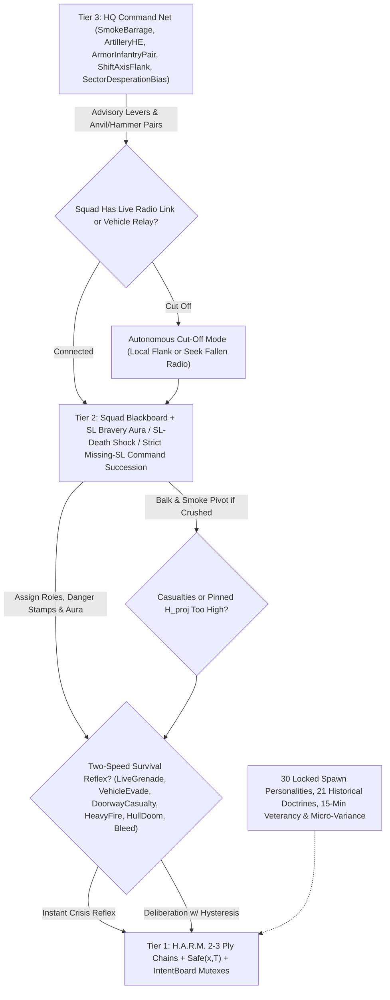

# Easy Red 2: Battle Hardened (`v0.10.6`)
*H.A.R.M. 3-Tier Emergent Decision Engine, Humanized Vision & Footstep Hearing, 9 Battle Atmosphere Directives, Asymmetric Danger Stamps, Radioman Intel Nets, 15-Minute Veterancy, 30 Personalities & Combined-Arms Overhaul*

**[What Is Battle Hardened](#what-is-battle-hardened)** · **[Why Vanilla Needed That Push](#why-vanilla-easy-red-2-needed-that-extra-push)** · **[Install & Mod Compatibility](#installation-and-mod-compatibility)** · **[Multiplayer Matrix](#multiplayer-compatibility-matrix)** · **[What Changes In-Game](#what-changes-on-the-battlefield)** · **[H.A.R.M. Architecture & Personalities](#harm-emergent-decision-engine-and-personalities)** · **[Hotkeys](#in-game-hotkeys-and-menus)** · **[Verification & Performance](#automated-verification-and-performance-profiling)** · **[Engineering Deep-Dive](docs/design-and-justifications.md)** · **[Changelog](CHANGELOG.md)**

---

## What Is Battle Hardened

***Battle Hardened*** is a **tactical AI realism, Co-op, and combat immersion overhaul** for *Easy Red 2* (BepInEx 6 IL2CPP).

**Built for realism, not artificial difficulty — zero aimbots, zero 360° ESP, zero HP bloat.**  
*Battle Hardened* is not a "hardcore laser-bot" mod. Powered by **H.A.R.M. (*Heuristic Action & Risk Model*)**, our custom 3-Tier Emergent Decision Engine gives bots real human sight cones, footstep acoustics, reaction delays, fear, and self-preservation—so sneaking, flanking armor, and knocking out enemy Radiomen or Officers genuinely pay off while your own teammates fight smarter beside you (the previous legacy GOAP architecture is archived on the `GOAP` git tag).

* **Co-op Host-Only Friendly**: Host for **unmodded vanilla friends** (they experience the upgraded AI, resurrected vanilla voice lines, Host-Assist wood/top-attack penetration, and targeted radio/welcome briefings with zero install) or play **100% client-side** on vanilla servers.
* **Built for `140+` Bot Battles (`60 FPS` Target + Live Self-Verification)**: Zero-allocation bit-packed stimulus & world structs, chunked world/inventory snapshots, `43`-bucket `Stopwatch` flight recording, `65/65` leak-audited scene-reset caches, automatic `< 40 FPS` brain-tick backoff, and an opt-in **Live Performance & Mod CPU Overlay** (`F6 -> Tab 5`) so you can verify exact `ms/frame` cost mid-battle against `F8` Vanilla.
* **100% Live-Configurable (`F6`) & Toggleable (`F8`)**: Tune or disable **`115` options** across **5 tabs** mid-match from the `F6` menu (`BepInEx\config\com.antigravity.easyred2.humanai.cfg`), or press **`F8`** at any moment to switch cleanly back to 100% vanilla behavior without restarting.

---

## Why Vanilla Easy Red 2 Needed That Extra Push

Vanilla *Easy Red 2* puts **140+ infantry, tanks, halftracks, artillery, and aircraft** onto large destructible battlefields at 60 FPS using lightweight stateless shortcuts in `GameAssembly.dll`. Once you slow down and watch individual squads in a firefight, several structural gaps appear:

| Area | What Vanilla Does Under the Hood | How *Battle Hardened* Fixes It |
| :--- | :--- | :--- |
| **Reaction & Brain Ticks** | `Creature.ProcessSequentialUpdates` ticks **only 1 unit per frame** (even dead or passenger slots) — leaving bots waiting **`~2.0–2.5s`** between brain updates in 140-bot battles, or frozen behind a flat `2.5s` `alertStartTime` delay. | **Adaptive Brain Scheduler (`~0.6s` latency)** skips wasted slots cleanly (backing off automatically if frame time exceeds `25ms`) and adds **Dynamic Human Reaction ("Watching vs. Caught Out")**: `0.18s–0.32s` if pre-aimed downrange vs. `0.38s–0.65s+` when caught sprinting or flanked. |
| **Sight Cones, Footsteps & Stealth** | When hidden, prone visibility is `37m`. The instant *any* squadmate fires (`IsEnemyAwareOfThisSquad`), every member jumps to **`300m` detection** and alerted bots skip FOV checks completely (**360° eyes in the back of their head**, even inside buttoned tanks!). | Preserves stance stealth (`150m` Standing / `80m` Crouched / `40m` Prone), reveals **only the soldier who fired** for `4.0s`, applies a continuous human **"Squint" cone** (`<= 12m` close awareness narrowing smoothly to `±32°` long range), adds **`<= 20m` footstep & gunfire hearing** (crouch/prone silent, masked by explosions), and gives enclosed tank gunners narrow optical slits fed by a **`0.65s–1.48s` Commander Intercom handoff**. |
| **Self-Preservation & Pathing** | Bots holster rifles to bandage in front of shooters, throw blind smoke backward along `LookRotation()`, get trapped on 2nd-story ruined floors or inside deep trenches, stand on the *enemy-facing side* of walls, walk under rolling friendly tanks, and mag-dump rifles & frag grenades at Tiger armor. | **Survival comes first**: **H.A.R.M.** two-speed reflexes, ballistic smoke screening toward real ground threats, gunfire-driven leeward walls, cover-before-bandaging (`CanSafelyBandageNow`), `Layer 14` vaulting + `<= 6.2m` elevated drop-off & trench escape (+ last-resort stuck surrender), moving-tank danger corridors, threat-arc Tank Fear, and shell-shock surrender/liberation. |
| **Teamwork & Macro Play** | Squads fight with static distance checks, abandon flags the second they're captured, camp *outside* capture circles, charge blindly into doorway conga-line killzones, and never depend on a Radioman to talk to HQ or armor. | **H.A.R.M. 3-Tier Chain of Command** with radio-honest asymmetric **Danger Stamps** (`H_proj`), Squad Leader **Bravery Aura & SL-Death Shock**, strict missing-SL **Command Succession**, Radioman-gated **Command Net**, inside-circle garrisons, NCO balks & smoke pivots, and combined-arms armor/air support. |

---

## Installation and Mod Compatibility

| Property | Details |
| :--- | :--- |
| **Target Branch** | Steam `public` (Default Branch) |
| **Confirmed Game Version** | **Easy Red 2 — Game Build `921`** (Steam Build ID `26375879`, Unity `2022.3.62f3` IL2CPP x64) |
| **Mod Loader** | **[BepInEx 6 Bleeding Edge (`BepInEx-Unity.IL2CPP-win-x64`, build `#791`+)](https://builds.bepinex.dev/projects/bepinex_be)** *(Windows, Linux/Steam Deck via Proton, & Experimental macOS)* |
| **Last Confirmed Build & Suite Date** | **November 25, 2026** (`2026-11-25`) |

Download your preferred package from the **[Releases](https://github.com/sudravirodhin/easy-red-2-ai/releases)** page:

### 1-Click Auto-Updating Launcher (`Launch-BattleHardened.bat`) — *Recommended*
Download **[`Launch-BattleHardened.bat`](Launch-BattleHardened.bat)** (run it from anywhere on Windows, or create a Desktop shortcut to it):
* Automatically locates your Steam `Easy Red 2` folder, checks GitHub Releases for the latest version (`SHA-256` & version verified in `< 1s`), updates `EasyRed2HumanAI.dll` only when a newer release is available (or installs the full `*-with-BepInEx.zip` bundle on a fresh vanilla install), and **launches *Easy Red 2* via Steam automatically**.
* If you only want to update without launching the game, run **[`Update-BattleHardened.bat`](Update-BattleHardened.bat)** instead.

### Option A: With BepInEx Included (`EasyRed2HumanAI-v0.10.6-with-BepInEx.zip`) — *For Manual Fresh Installs*
Includes **[BepInEx 6.0.0-be.791 (Unity.IL2CPP-win-x64)](https://builds.bepinex.dev/projects/bepinex_be)**, the `.NET 6` runtime, Unity `2022.3.62` base libraries, pre-generated IL2CPP `interop` assemblies for Easy Red 2 Build `921`, `EasyRed2HumanAI.dll`, and `Launch-BattleHardened.bat` / `Update-BattleHardened.bat` (with no other third-party mods).
1. Open your **Easy Red 2** installation folder (e.g. `Steam\steamapps\common\Easy Red 2`, where `Easy Red 2.exe` is located).
2. Extract all contents of `EasyRed2HumanAI-v0.10.6-with-BepInEx.zip` directly into the `Easy Red 2` folder.
3. Launch the game via Steam or `Launch-BattleHardened.bat`!

### Option B: Without BepInEx / Plugin Only (`EasyRed2HumanAI-v0.10.6-Plugin-Only.zip` or `EasyRed2HumanAI.dll`)
For users who already have **[BepInEx 6 Bleeding Edge (`BepInEx-Unity.IL2CPP-win-x64`)](https://builds.bepinex.dev/projects/bepinex_be)** installed:
1. Download `EasyRed2HumanAI-v0.10.6-Plugin-Only.zip` (or `EasyRed2HumanAI.dll` directly).
2. Place `EasyRed2HumanAI.dll` into:
   ```text
   Easy Red 2\BepInEx\plugins\EasyRed2HumanAI.dll
   ```
   *(Using **[Quartermaster - ER2 Mod Manager](https://www.nexusmods.com/easyred2/mods/107)**? Import `EasyRed2HumanAI-v0.10.6-Plugin-Only.zip` directly in Quartermaster's Mods tab—do not import `with-BepInEx.zip`.)*

### Linux & Steam Deck Setup (via Steam Proton)
`EasyRed2HumanAI` works out of the box on **Linux Desktop** and **SteamOS / Steam Deck** with 100% Windows Co-op cross-play compatibility by running the Windows IL2CPP build under **Proton**:
1. **Force Proton in Steam** *(do not use the native Linux runtime, as BepInEx IL2CPP hooks `Easy Red 2.exe` / `GameAssembly.dll`)*:
   * Right-click **Easy Red 2** in Steam → **Properties** → **Compatibility**.
   * Check **"Force the use of a specific Steam Play compatibility tool"** and select **Proton Experimental** or **Proton 9.0+**. Let Steam finish downloading `Easy Red 2.exe`.
2. **Extract the Mod**:
   * Right-click **Easy Red 2** → **Manage** → **Browse local files** (`~/.steam/steam/steamapps/common/Easy Red 2/`).
   * Extract **`EasyRed2HumanAI-v0.10.6-with-BepInEx.zip`** directly into that folder (`winhttp.dll`, `doorstop_config.ini`, `dotnet/`, and `BepInEx/` next to `Easy Red 2.exe`).
3. **Add the Wine DLL Override Launch Option** *(Required on Linux/Proton so Wine loads BepInEx's `winhttp.dll` proxy)*:
   * In Steam → **Easy Red 2** → **Properties** → **General** → **Launch Options**, paste:
     ```bash
     WINEDLLOVERRIDES="winhttp=n,b" %command%
     ```
4. Launch the game! Verify `BepInEx/LogOutput.log` shows `Easy Red 2 - Battle Hardened v0.10.6 loaded!`. Both Windows and Linux/Proton players can Host or Join each other's Co-op lobbies. *(Also see [docs/MACOS_EXPERIMENTAL.md](docs/MACOS_EXPERIMENTAL.md) for Apple Silicon macOS testing.)*

### Switching to Vanilla or Uninstalling (`Uninstall-BepInEx-Mod.bat`)
Included in `EasyRed2HumanAI-v0.10.6-with-BepInEx.zip` (and in the root of this repository) is **[`Uninstall-BepInEx-Mod.bat`](Uninstall-BepInEx-Mod.bat)**. Run it inside your `Easy Red 2` folder when the game is closed to:
* **`[1] Play Vanilla Temporarily`**: Backs up `BepInEx`, `dotnet`, and `winhttp.dll` into `_BepInEx_Disabled_Backup\` so the game runs 100% vanilla without losing configs or plugins.
* **`[2] Restore Modded Game`**: Restores everything from `_BepInEx_Disabled_Backup\` in one click.
* **`[3] Uninstall Completely`**: Permanently deletes BepInEx and installed files.
*(Tip: Press **`F8`** in-game to disable the AI mod mid-match without restarting!)*

### Stacking With Other BepInEx Mods
* **Do not stack other full AI / movement overhauls** (e.g., *UngodlyAI*, *Advanced Combat Movement*)—multiple mods patching `SoldierAI`, `Creature.CanSee`, and `Squad` simultaneously will fight over bot locomotion and target selection.
* **Pairing with ballistics, gunplay, or visual mods** (e.g., *Realism Overhaul*, *Gunplay Overhaul*, *Better Scopes*): *Battle Hardened* includes optional armor/ballistics and QoL modules ([`BallisticsAndArmorRealism.cs`](src/EasyRed2AI/Modules/ImmersionAndQoL/BallisticsAndArmorRealism.cs), `TurretGun.SelectBestAmmo`). Every realism and QoL hook is independently toggleable live under **`F6 -> 3. Vision & Realism`** and **`F6 -> 5. Optimizations & QoL`**, so you can disable any overlapping ballistics/armor option without giving up the H.A.R.M. AI.

---

## Multiplayer Compatibility Matrix

Whether you are **joining a 100% vanilla server as a modded client**, **hosting a server for vanilla friends**, or running the mod on **both Host and Clients**, here is how every feature behaves over Photon (`PUN2`):

| Feature / System | Category | Joining a Vanilla Server (Client-Only Mod) | Hosting for Vanilla Friends (Host-Only Mod) | Host + Clients Both Modded |
| :--- | :--- | :--- | :--- | :--- |
| **Plane Engine Loop De-Throbber** (`EnablePlaneAudioSmoothing`) & **Individualistic Voice Pitch** (`EnableDynamicSoldierVoicePitch`) | **100% Client-Side Audio** | **Works 100%** for you | Host hears smoothed plane audio & deterministic soldier voice pitch; vanilla clients hear vanilla audio | **Everyone** hears smoothed plane audio & per-bot pitch |
| **Death Screen Kill Attribution (`Bled out` on delayed bleed-outs, clean weapon/hit-zone cause on direct kills) + Age & `F7` Dogtag Archive** | **100% Client-Side** | **Works 100%** for you | Host sees full obituary & archive; vanilla clients see vanilla death screen | **Everyone** sees full obituary & archive |
| **Quick-Tap `Tab` Spotting & 64-Char Room Names** | **Client UI / Host Room Name** | **Works 100%** for you | Vanilla clients see your full 64-char server name! | **Works 100%** for everyone |
| **3D Veteran Badges, Revived Roster Fix, `[RALLIED SL]`/`[SL SHOCK]`, Spectator HUD (`F`), Free-Cam Stabilization, 4K UI Scale & `F5`–`F10`** | **100% Client-Side UI / Camera** | **Works 100%** on your HUD | Host only (vanilla clients see **3D uniform shoulder rank decals** synced by Host) | **Everyone** sees HUD tags, 3D badges & decals |
| **HQ Objective Command, Garrisons, Attrition Pivots, Emplacements & Smart APCs** | **Host-Driven (Synced to All)** | Inactive (Host controls autonomous squads) | **Vanilla clients experience 100%!** Host assigns squad tasks and Photon syncs movements & dismounts to vanilla players. | **Works 100%** for everyone |
| **All Autonomous AI Squads (H.A.R.M. Engine, Vision, Footsteps, Radios, Ballistic Smoke, SL Bravery Aura/Shock, Voice Callouts, CQB & Tank Bailouts)** | **Host-Driven (Synced to All)** | Inactive for host-owned bots | **Vanilla clients experience 100%!** Even a vanilla client's **own on-foot AI squadmates** remain simulated by the Host (`0x180A71EE2`) and emit native Photon `SyncSay` voice lines! | **Works 100%** for everyone |
| **Vehicle & Aircraft Physics / Flight & Photon Sync** | **Vanilla Sync + Anti-Desync Safety** | Pure vanilla network sync | **100% wire-compatible ~8.3 Hz pilot sync & remote anti-ground-smash fix!** Remote client planes glide smoothly on Host without false ground-locks or crash desyncs. | **100% synchronized** on Host & Clients |
| **AI Crewmates Inside a Client-Driven Tank/Vehicle** | **Client-Owned Vehicle Crew** | **Works 100%** for your vehicle's AI gunners/repair crew! | Vanilla client's own tank crew uses vanilla AI while that client drives | **Works 100%** for everyone |
| **Thin-Cover Wood Penetration, Human Over-Penetration & Aircraft Top-Attack AP (`"bh_ver"` Host-Assist)** | **Per-Shooter + Host-Assist** | Works for you & locally owned units | **Vanilla clients experience 100%!** Host applies thin-wood, human over-penetration & top-attack penetrations for unmodded teammates without double-damage. | **Works 100%** for everyone |
| **Multiplayer Scoreboard (`Kills`/`Deaths`/`Score`), Client Roadkills, Targeted Host MOTD & Battle Stat Sync** | **Host-Authoritative / Synced** | Scoreboard fix works for your kills/deaths; Roadkills & match stats sync when Host runs mod | **Vanilla clients experience 100%!** Unmodded friends can roadkill enemy bots, see sorted scoreboards, and receive faction-language welcome briefings & targeted WWII radio chat. | **100% synchronized** on Host & Clients |
| **Enclosed Tank Crew Blast & Airplane Canopy/Belly Armor** | **Per-Victim Owner** | Protects you & locally owned crew | Protects Host + **all Host-owned AI tank crews & pilots** | **Works 100%** for all players and AI |

---

## What Changes on the Battlefield

### 1. H.A.R.M. Single-Authority AI & Asymmetric Squad Dynamics ([`Modules/Emergent/`](src/EasyRed2AI/Modules/Emergent/) & [`Modules/Goap/`](src/EasyRed2AI/Modules/Goap/))
* **Unified 3-Tier Emergent Decision Engine ([`EmergentDecisionCore.cs`](src/EasyRed2AI/Modules/Emergent/EmergentDecisionCore.cs), [`EmergentRuntimeBridge.cs`](src/EasyRed2AI/Modules/Emergent/EmergentRuntimeBridge.cs))**: Replaces separate legacy pre-GOAP movement interceptors with **one single tactical authority** per soldier, tank, and aircraft driven by two terminal goals (**`Survive`**, **`Win`**), one platform-gated lethality lever (**`CanHarm > 0`** so riflemen facing heavy tanks evade or smoke instead of suiciding), **two-speed survival reflexes**, **commitment hysteresis** (zero flip-flop thrashing), **bounded `2–3` ply chains**, **`Safe(x, T)` duration gating**, and **`IntentBoard` exclusive mutexes / `CanAid` helper caps**.
* **Radio-Honest Asymmetric Danger Stamps & Doorway Reflex**: Real friendly casualties and heavy penetrations write directional/weapon-classified danger impulses (`SmallArms`, `ExplosionHE`, `AntiTank`, `Artillery`) into each side's `DangerStampRing`. Fresh (`4m`) doorway casualties immediately halt follower conga-lines (`DoorwayFreshCasualty -> SeekCover` or `PopSmoke`), while enemy casualty stamps emit **Enemy Harm Relief** surges inviting local suppression & flanking pushes—both strictly visible only inside radio range until squad runners or HQ relays connect.
* **Squad Leader Bravery Aura, SL-Death Shock & Command Succession**: Alive officers and aggressive acting leaders project a proximity-scaled **Bravery Aura** tightening squad grit and pushing borderlines forward (`ComputeLeaderBraveryAura`). When an SL is killed, downed, or surrenders, survivors suffer a decaying **`20s` SL-Death Morale Shock** (`LeaderShockPeak` / `LeaderShockUntil`). When a squad's SL is actually missing/lost (never at vehicle/APC/plane spawn and locked out after one succession attempt until another SL goes missing), the next acting leader—**player or AI identically**—has a veterancy-scaled chance (`20%` Recruit / `30%` Vet I / `45%` Vet II / `60%` Vet III ★) via **Command Succession** to step up into `[Spearhead]`, `[Tactician]`, or `[Old Guard]`, softening morale shock and notifying the player.
* **Emergent Field Radios, Medic Kits, Primary Upgrades & Bailed Crew Scavenge**: Surviving squadmates inherit fallen **friendly or captured enemy field radios** (`Soldier.SetWerable` + retuned freq) and atomic **3-of-3 syringe kits**, drag wounded buddies out of projected killzones (`pHarm < 0.35`), deploy AT mines / satchel charges safely (`9m` clear step-back), and let **pistol/SMG-disarmed or bailed vehicle crews** urgently upgrade to dropped rifles/SMGs from corpses both before and after joining infantry squads (`NeedsPrimaryWeaponUpgrade`).
* **Close-Range Footstep & Gunfire Hearing (`<= 20m`) + 4 Resurrected Vanilla Voice Lines**: Zero-allocation footstep ring buffer detects standing sprints (`<= 17m`) and walks (`<= 9.5m`) while keeping crouched/prone stealth silent and masking `50%` under explosions/gunfire (`<= 35m`, `3s`). Wires **`492` unused universal vanilla voice clips (`48/48` sets)** (`iVeBeenHit`, `attackThatTank`, `attackThatVehicle`, `yes` + safe fallback) over Photon `SyncSay` with deterministic per-soldier **Voice Pitch Personality** (`0.92x–1.08x`).

### 2. Infantry Self-Preservation, Ballistic Smoke & Obstacle Escape ([`Modules/Infantry/`](src/EasyRed2AI/Modules/Infantry/))
* **Committed Fire-and-Movement, Leeward Cover & Crossfire**: Alternates locked **upright sprints (`4.8s–6.8s`)** with **kneeling firing halts (`3.7s–5.35s`)**, reacts with `"Shot-At"` startle drops (`0.16s–0.43s`), chooses cover on the **gunfire leeward side** of walls with circular-coherence crossfire protection (`R < 0.82f` favoring roofed interior/trench shelter without ping-ponging), peeks over waist-high walls only during firing bursts, sidesteps concrete lintels via dual-height barrel checks, and yields out of human players' aim corridors (`PlayerAimLane`).
* **Unified Ballistic Smoke Intercept (Fixes Opposite-Direction Smoke)**: Fixes native `Soldier.Throw` -> `<InstantiateAndThrowAfter>d__594` falling back to `Soldier.LookRotation()` whenever `aimTarget == null` or `CalculateBallisticThrow` exceeded max range. Both mod (`ExecuteGoapThrowSmokeScreen`, retreat smoke) and vanilla (`SoldierAI.SequentialUpdate`) smoke throws are intercepted and clamped inside exact ballistic arc range along the line between the thrower and a verified ground threat (filtering out aircraft and blocking blind indoor/backward throws).
* **Upper-Floor Cliff Step-Off (`<= 6.2m`), Trench Escape, Vaulting & Last-Resort Surrender**: Combines `Layer 14` (`InvisibleTrepassableWall`) parapet vaulting with safe trench drop-in (`TryStepOffIntoTrench`), wide `6.5m` room/trench entrapment tracking (so small-room pacing doesn't reset unstick counters), survivability-aware **2nd-story ledge drops & window drop-vaults** (`<= 6.2m` matching native ER2 `groundLeaveY` fall physics, `3.2m` if bleeding), widened stuck trench-parapet slope tolerances, bridge drop-off guards (`GetSpacingFromSquad`), and clean **last-resort `"stuck_trapped"` surrender** after `>= 45s` entombed (excluded from AI liberation dogpiles).
* **Decisive Melee & Dynamic Surrender**: Mounts integrated bayonets cleanly without RPC bursts, extends un-bayoneted AI `MeleeDamageCR` reach (`0.37m -> 0.95m`, `1.45m` over tripods), stops CQB spin/whiff loops, fixes downed-casualty vs. surrender standing-zombie bugs, and enables dynamic shell-shock surrender & liberation for isolated overwhelmed troops.

### 3. Relentless Objective Play, HQ Command Net & Spawn Rescue ([`Modules/MacroAndVehicles/`](src/EasyRed2AI/Modules/MacroAndVehicles/))
* **Both Armies Play to Win & 9 Battle Atmosphere Directives**: Retains doctrinal rear garrisons (`16%–28%`) with instant Back-Cap Alarms, applies **9 historical Battle Atmosphere Directives** (**Order No. 227**, **Kessel Pocket**, **Urban Fortress**, **Amphibious Beachhead**, **Siege of Bastogne**, **Pacific Bunker & Night Gyokusai**, **Mountain Ridge Grind**, **Blitzkrieg Schwerpunkt**, **Night Airborne Op**) with a single **`[HQ Dispatch]`** chat broadcast on spawn (Solo & Co-op), fights inside capture zones (`0.80 * radius`, sweeping contesters when cap progress ticks down), orchestrates `SmokeBarrage` / `ArtilleryHE` / `TankDispatch` / `ArmorInfantryPair` / `CasVector` / `ShiftAxisFlank` / `SectorDesperationBias` Command Net levers across all `215+` missions (`ME_*`, `sp_ME_` V2, Dynamic Conquest, Wave Defense, Demolition), pairs pinned human squads (**Anvil**) with AI flanking squads (**Hammer**), preserves `ConquestEconomy` strictly for human players, and rescues coastal/boat-overflow spawns onto dry walkable terrain.

### 4. Fair Human Vision, Tank Commander Periscope & Realistic Ballistics ([`Modules/Vision/`](src/EasyRed2AI/Modules/Vision/) & [`Modules/ImmersionAndQoL/`](src/EasyRed2AI/Modules/ImmersionAndQoL/))
* **Fair Vision & Window-Aperture Alignment**: Preserves `150m` Standing / `80m` Crouched / `40m` Prone stealth with `4.0s` individual shooter reveals, continuous human "squint" cones (`<= 12m` -> `±32°`), `0.18s–0.65s+` human reaction timing, optic zoom scaling (`<= 2.25x`), native `AngleToDirection` `90°` gaze fix, window-opening alignment for indoor defenders, and `15m` vocal threat callouts.
* **360° Tank Periscope, Intercoms & Armor Realism**: `TurretCommander` sweeps (`55°/s`) or tracks gunfire (`<= 185m`) with `11.5m` hull dead zones and **`0.65s–1.48s` Commander & infantry-escort intercom handoffs** into narrow gunner slits (`±15°–34°`); protects buttoned crew against external frags and collider clips; filters `0`-armor tent/soft-prop tank collisions; grants Molotov track immunity; adds diving aircraft **top-attack AP roof normalization** + armored plane bellies; adds thin-cover wood penetration (`Host-Assist` included); and occludes underwater/smoke blood impacts and corpse/ground blood decals (`LimbLeftoverManager` + `CorvoDecal`).

### 5. Combined Arms: Armor, Emplacements, Moving-Tank Corridors & Bailouts ([`Modules/MacroAndVehicles/`](src/EasyRed2AI/Modules/MacroAndVehicles/))
* **Moving-Vehicle Forward Danger Corridors**: Refreshes up to `32` moving vehicle danger corridors at `10 Hz` so friendly infantry step sideways out of rolling tank tracks (`VehicleEvade` fast reflex, undeploying bipods/cover cleanly) and never pick `CombatCover` inside a moving friendly tank's forward lane.
* **Tank `RepairStation` Health Fix, Munition Selection & Pure Vanilla Driving/Flight**: Keeps vanilla driving (`UpdatePath`), flight physics (`FlightModel`), and Photon vehicle sync 100% pure while layering facade shelling, coax MG vs. true `APHE`/`HE`/`Flak` selection (`TurretGun.SelectBestAmmo` + `TurretWeapon.Reload`), hull/blast displacement, and accurate remaining-health `RepairStation` routing (`1.0 - MovableVehicle.GetPercentageDamageFor()`, resolving inverted `dmg:100%` flip-flops with `Order.defend` + `24s` stalled-route watchdog).
* **Emplacements, Anti-Armor & Air/Crew Bailouts**: Proactively crews 2-seat static guns (and assists player guns within `32m`) while bailing gunners when flanked/rushed; keeps stowed AT launchers ready against halftracks/armored cars; enforces threat-arc Tank Fear + blind-side stalking; restores `2200m`/`4000m` air detection, carrier `NeedRefill` rescue, and H.A.R.M. CAS/CAP air tasking; restricts *Tokkōtai* dives to crippled planes; and runs staggered crew bailouts (`0.15s–0.45s` hatch queue + shock scramble + sea-ditching retreat).

### 6. Immersion, Free-Cam Stability, Obituary, `F5`/`F6`/`F7` UI & 60 FPS Co-op Polish ([`Modules/ImmersionAndQoL/`](src/EasyRed2AI/Modules/ImmersionAndQoL/) & [`UI/`](src/EasyRed2AI/UI/))
* **Audio, Free Cam & HUD Clarity**: Individualistic deterministic **Soldier Voice Pitch**; **Plane Engine Loop De-Throbber**; **Free-Cam Plane/Vehicle Stabilization** (disables jittery `TrackingRigidbody`, cancels `ShakeCameraRoutine` in cinematic cam, normalizes lock-on targets to root vehicle transforms, zeroes camera roll); **Revived Squadmate HUD Sync** (fixes red downed name colors & cleans `SquadSoldierLabel` states); **Death Screen Obituary** (`"Bled out"` on delayed bleed-outs, clean weapon/hit-zone cause on direct kills, caliber, Age, Event `197` MP sync) & searchable **`F7` Dogtag Archive**; Bottom-left Squad Roster (`[RALLIED SL]`, `[SL SHOCK]` / `[RALLIED]` / `[BRAVERY +X%]`) & Gold/White squad letters; **Tactical Reload/Bipod Canceling**; **64-char room names**, quick-tap `Tab` spot, localized Welcome MOTD, `16s` MP anthem fade, **4K UI scaling**, Spectator **`F` Command Net Overhead (`Mode 4`)** & **`F8` Vanilla A/B Observer**, standalone **`F5` Campaign/Playlist/Difficulty Picker**, **`45 FPS` unfocused Host cap**, and **Host Ping Governor**.

---

## H.A.R.M. Emergent Decision Engine and Personalities

Instead of static `if HP < 50 -> bandage` rule trees or blind cost tables, **H.A.R.M. (*Heuristic Action & Risk Model*)** models every agent around two drives (**`Survive`**, **`Win`**), modulated by live **Projected Harm (`H_proj`)** from radio-honest `DangerStamp`s, platform lethality (**`CanHarm > 0`**), **Two-Speed Survival Reflexes**, and bounded **`2–3` ply prerequisite chains**:



No two soldiers of the same nation fight identically: MurmurHash3 bit-mixing generates per-soldier continuous micro-variance (`RiskThreshold`, `Individualism`, voice pitch, suppressed grit) layered beneath locked **Spawn Role Personalities**, **21 Historical Doctrines**, **9 Battle Atmosphere Directives**, and **15-Minute Veterancy**.

<details>
<summary><b>Click to expand the 30 Role-Based AI Personalities reference table</b></summary>

| Role | Personality 1 | Personality 2 | Personality 3 |
| :--- | :--- | :--- | :--- |
| **1. Squad Leader** | **`[Spearhead]`**: Strongest forward Bravery Aura & suppression grit. | **`[Tactician]`**: Faster artillery/radio support checks and tight cover discipline. | **`[Old Guard]`**: Defensive anchor; prioritizes squad survival and rescues pinned comrades. |
| **2. Assaulter / SMG** | **`[Shock]`**: Resists dropping `Prone` until extreme suppression (`>= 68`) and bounds aggressively. | **`[Breacher]`**: Rapid `2.0s` peek cooldown (`<= 38` suppression) and eagerly tosses frag grenades. | **`[Skirmisher]`**: Expands lateral spacing (`1.45x`) to flank wide into CQB. |
| **3. Rifleman** | **`[Regular]`**: Balanced baseline fire-and-maneuver (`35` suppression threshold). | **`[Cautious]`**: Drops low at light suppression (`>= 18`), stays ducked longer, sheds jitter as `[Composed]` Vet. | **`[Grenadier]`**: Prioritizes rifle-grenades and hand grenades within throwing range. |
| **4. Machine Gunner** | **`[Anchor]`**: Prioritizes wall/parapet bipods and holds under heavy fire (`>= 60` suppression). | **`[Assault MG]`**: Advances with the rifle squad and deploys ground bipods in `Crouch`/`Prone`. | **`[Overwatch]`**: Holds medium-long range (`50m–160m`) overwatch cover to pin threats. |
| **5. Marksman / Sniper** | **`[Deadeye]`**: `12%` tighter accuracy when firing from `Crouch` or `Prone`. | **`[Stalker]`**: `35%` shorter firing-reveal duration from concealed cover. | **`[Spotter]`**: `+5°` wider scoped optic cone for counter-sniping. |
| **6. Anti-Tank / Sapper** | **`[Tank Hunter]`**: Stalks armor in crouch stealth and aims for tracks/weak spots. | **`[Ambusher]`**: Holds fire behind cover until armor enters kill range (`< 68m`). | **`[Demo]`**: High suppression grit (`>= 60`) when closing for AT/satchel/grenade attacks. |
| **7. Field Medic** | **`[Heroic]`**: Braver under fire (`<= 52` suppression) and searches `1.5x` wider (`45m`) to rescue/liberate. | **`[Combat Medic]`**: Balanced combat-first medic (`35` suppression); clears close threats before treating. | **`[Triage]`**: High self-preservation (`20` suppression, longer cover-seek) to stay alive for the squad. |
| **8. Tank / Armor Crew** | **`[Brawler Crew]`**: `20%` faster turret target switching, higher H.A.R.M. close-support risk tolerance & fastest bailout recovery. | **`[Sniper Crew]`**: `+5°` wider long-range turret optic cone & standoff-weighted fire discipline. | **`[Support Crew]`**: Faster radio-request target switching & infantry-support repair/bailout discipline. |
| **9. Light Vehicle / AA** | **`[Outrider]`**: Fast-reacting mobile gunner/driver (`20%` faster turret refresh). | **`[Escort]`**: Cautious standoff support and higher self-preservation when repairing. | **`[Flak Watch]`**: `+12°` wider scan sector in `TurretAI.CanSee` for tracking aircraft. |
| **10. Aircraft Pilot** | **`[Ace]`**: Extended dogfight pursuit leash (`fighterDogfightExtraLeash = 450m`). | **`[Daredevil]`**: Commits closer on CAS dive-bombing runs (`0.90x diveAlignDistance`). | **`[Disciplined]`**: Pulls out of dives earlier (`1.08x diveAlignDistance`) for safer bomb releases. |

</details>

For native `GameAssembly.dll` RVAs, architecture notes, and settled invariants across all **35 C# files**, see **[`docs/design-and-justifications.md`](docs/design-and-justifications.md)** and **[`CHANGELOG.md`](CHANGELOG.md)**.

---

## In-Game Hotkeys and Menus

Every feature is organized into **5 Tabs** (`1. H.A.R.M. & Bot Behaviors`, `2. Vanilla Fixes`, `3. Vision & Realism`, `4. Vets & Roles`, `5. Optimizations & QoL`) with one-click **`[ALL]` / `[OFF]`** section buttons in **`F6`** (`BepInEx\config\com.antigravity.easyred2.humanai.cfg`):

* **`F` (in Free Camera / Auto-Spectator)**: Cycle Spectator Tactical View (**`Full Tactical`** $\rightarrow$ **`Objectives Only`** $\rightarrow$ **`Clean Cinema`** $\rightarrow$ **`Command Net Overhead`** + live **`F8`** Vanilla A/B Observer), independent of Photo Mode's camera UI toggle.
* **`F5`**: Open/Close the standalone **2-Tab Campaign, Multi-Map Playlist & Match Settings Picker** (SP & MP Host: build `[+]`/`[#N]` playlists, **`Campaign From Here`**, synced vanilla `Difficulty` & `Match` settings, `25%–300%` Allies/Axis Bot Scale, and `???` unlock masking).
* **`F6`**: Open/Close the **5-Tab Modular Feature Menu** (live-toggle all `115` config options mid-match + 1440p/4K UI scaling).
* **`F7`**: Open/Close the **Searchable Dogtag Collection Archive** (`Brought Home` vs. `Enemy Trophy`, `My Kills`, Age, rarity, and battle filter).
* **`F8`**: Master Toggle Mod **ENABLED / DISABLED** live in-game.
* **`F9`**: **Hot-Reload** `.cfg` from disk without restarting.
* **`F10`**: Display the **6-Line Live Tactical Telemetry Card** (`MaxFrame`, `Hitches`, `Vet`, `HARM`, `Retreat`, `Smoke`, `WepUp`, `RadioLoot`, `RoadkillSaved`, `FFSaved`, `Surr/Lib`, `PatchErrs`, `Anoms`, etc.). Zero-overhead opt-in **`Live Performance & Mod CPU Overlay`**, **`Hitch Flight Recorder`**, and **`Bot Action Trace`** (`BepInEx/BotActionTrace.jsonl`) live under `F6 -> 5. Optimizations & QoL -> Performance & Diagnostics` (all default `OFF`).

---

## Automated Verification and Performance Profiling

Every edit compiles through a two-stage verification pipeline and has been tested in multi-hour live playtests (`0` mod errors):

### 1. Static Signature Checks, Memory-Leak Audit & Headless Simulations (`.\build.ps1 -Test`)
| Verification Stage | Scope | Verified Result |
| :--- | :--- | :--- |
| **IL2CPP Harmony & Animator Verifier** ([`VerifyPatches.cs`](tools/verify_patches/VerifyPatches.cs)) | All `[HarmonyPatch]` classes, `Plugin.Load` `SafePatch` registration CIL audit, `6` `_d__` coroutine targets, and Animator parameter/state literals vs. native `Soldier.asm` | **`196` HarmonyPatch signatures verified (`0` mismatches)**; **`16` Animator string literals verified (`0` mismatches)** |
| **Static Memory-Leak & IL2CPP Safety Audit** ([`VerifyPatches.cs`](tools/verify_patches/VerifyPatches.cs)) | All static `Dictionary<IntPtr, ...>` caches checked for `Clear`/`Remove`/`Prune` eviction paths + forbidden stripped/generic IL2CPP traps | **`65/65` static `IntPtr` dictionaries verified (`0` leaks)**; **`0` IL2CPP footguns** |
| **Emergent H.A.R.M. Core Suite** ([`VerifyEmergentEngine.ps1`](tools/verify_patches/VerifyEmergentEngine.ps1)) | `21` test groups covering doorway conga-line reflexes, `DangerStamp` harm relief, `CanHarm` armor immunity, `Safe(x,T)` gating, 2–3 ply chains, `IntentBoard`, `CanAid`, SL Bravery Aura & SL-death shock, doctrines, CQB lock, air CAS/CAP, crew weapon upgrades, scavenging & live playtest behavioral invariants | **`60 passed, 0 failed`** |
| **11-Suite Physics, Geometry, Vision & Armor Matrix** ([`VerifyPhysicsAndAcoustics.ps1`](tools/verify_patches/VerifyPhysicsAndAcoustics.ps1)) | Zero-allocation acoustic ring buffer, ground probes, CQB standoff capsules, 9 Battle Atmosphere profiles, human bullet over-penetration, `1.5m–180m` infantry/AT over-wall & auto-peek geometry, vision/camo curves, armor scoring, FF cones, 3D vaulting, and tanks/emplacements/planes/crews | **`658 assertions passed (0 failures)`** |
| **Deterministic Battle Loss & Emergence Model + Emergent Path Auditor** ([`Run-BattleLossModel.ps1`](tools/verify_patches/Run-BattleLossModel.ps1), [`Run-EmergentPathAudit.ps1`](tools/verify_patches/Run-EmergentPathAudit.ps1)) | **`687` battles** (`229` scenarios × `3` seeds across **`215` real campaign missions**, **`21/21` doctrines**, **`9` atmosphere directives**) + 5-pass contract/convergence auditor | **`8,609,176` Emergent plans**; **`0` across all `8` zero-tolerance loss counters** (`8,088` live-state audits); **`8/8` determinism**; **`229/229` cross-seed emergence**; `2.62` actions/engaged squad; **`98.5%` plausible combat deaths** (`369,928` deaths); **Path Audit: `CRITICAL:0 HIGH:0 MEDIUM:0`** |

### 2. In-Game Flight Recorder Telemetry (`HitchAutopsy` & `BotActionTrace`)
Profiled across long live matches (`~35`-minute full-battle `HitchAutopsy` + `BotActionTrace.jsonl` traces with `32,063` recorded events and `89,120` HARM decisions):
* **Sustained `60 FPS` (`16.7ms` avg)** with **`0` mod exceptions** and tiny per-frame hook cost (`MovementRoutine ~0.5–1.1ms` across ~200 calls, `CanSeeMod ~0.1–0.3ms`).
* **Runtime Diagnostics**: Opt-in `43`-bucket [`HitchProfiler`](src/EasyRed2AI/Core/HitchProfiler.cs) (`HitchAutopsy` + `15s` `[HitchSummary]`), **Live Performance & Mod CPU Overlay**, lock-free [`BotActionTrace`](src/EasyRed2AI/Core/BotActionTrace.cs) (`InspectInterop.dll --trace <BotId|sq:SqId|ev:Kind>`), `[MatchSummary]`, `PatchErrs`, and a `6`-detector runtime `AnomalyWatchdog`.

### 3. Verify Performance Yourself (Zero-Trust Guarantee)
* **Live `F8` A/B & Mod CPU Pill**: Enable **`Live Performance & Mod CPU Overlay (F8 A/B)`** under `F6 -> 5. Optimizations & QoL`, turn VSync OFF, and press **`F8`** mid-battle to watch `Mod CPU` drop to `0.00ms/f` in real time.
* **Two-Minute Reproducible Benchmark + Trace/Log CLI**: Run `dotnet tools/gen_interop/InspectInterop.dll --hitch-compare` to output a frame-weighted Markdown/BBCode `F8 OFF` vs. `F8 ON` comparison from `LogOutput.log`, or `--trace` to inspect any bot/squad in `BotActionTrace.jsonl`. Full guide in **[`docs/PERFORMANCE_BENCHMARKING.md`](docs/PERFORMANCE_BENCHMARKING.md)**.

### 4. Test Hardware Transparency & Tuning
Live profiling runs were captured on:
* **CPU**: AMD Ryzen 7 9800X3D (8-Core) · **GPU**: AMD Radeon RX 7900 XTX · **RAM**: 64 GB · **OS**: Windows 11 Pro

Optimization targets hardware-independent bottlenecks that help mid-range and lower-spec CPUs as well: primitive `IntPtr` handle caches (`AiCore.SoldierFastHandles` / `VehicleFastHandles`), octant-cached cover probes (`<= 40/frame`), progressive vault slope backoff (`0.85s -> 1.50s -> 2.35s`), automatic `< 40 FPS` brain-tick backoff, RPC rate-limiting, and `45 FPS` unfocused Co-op Host cap.  
**Honest tradeoff note:** Cranking **Bot Scale (`200%–300%`)** in `F5` multiplies *vanilla* Unity physics, pathfinding, and ragdolls regardless of AI settings; keep Bot Scale near `100%` on older CPUs.

---

## Building From Source

Run [`build.ps1`](build.ps1) from PowerShell (auto-discovers your Steam `Easy Red 2` installation and `.NET 6` Roslyn compiler, compiles all **35 files** under [`src/EasyRed2AI/`](src/EasyRed2AI/), runs [`VerifyPatches.cs`](tools/verify_patches/VerifyPatches.cs), and refreshes `tools/er2_cache/mod_index.md`). Add `-Test` to run `VerifyEmergentEngine.ps1`, `VerifyPhysicsAndAcoustics.ps1`, and the **687-battle Deterministic Battle Loss & Emergence Model**:

```powershell
powershell -ExecutionPolicy Bypass -File .\build.ps1 -Test -Deploy
```

---

## Development Methodology, AI Disclosure, and Credits

> **Disclosure — AI-Assisted Development:**  
> AI / LLMs were used in the development of this mod. I'm a developer by trade and worked on this with an LLM in my free time alongside hours of testing and polish. Included here for transparency — the full source, tests, and benchmarks are open to inspect.

**Credit & Inspiration:**  
Special credit and thanks to **[AtlasActual (`Easy-Red-2-Realism-Overhaul`)](https://github.com/AtlasActual/Easy-Red-2-Realism-Overhaul)** for pioneering several of the combined-arms, objective-coordination, and tactical realism concepts that inspired parts of this project's roadmap and feature sets.
