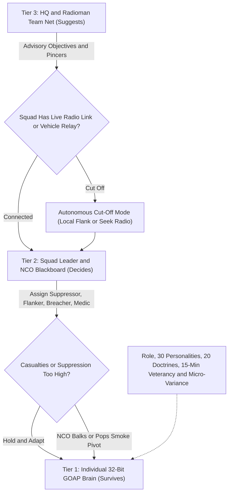

# Easy Red 2: Battle Hardened (`v0.8.9`)
*F.E.A.R.-Style 3-Tier GOAP, Humanized Vision & Self-Preservation, Radioman Intel Nets, 15-Minute Veterancy, 30 Personalities & Combined-Arms Overhaul*

**[Why Battle Hardened?](#why-vanilla-easy-red-2-needed-that-extra-push)** · **[What Is GOAP?](#background-what-is-goap-fear--ww2-combined-arms)** · **[What Changes In-Game](#what-changes-on-the-battlefield)** · **[Installation](#installation-two-release-options--linux--proton)** · **[Multiplayer Matrix](#multiplayer-compatibility-matrix--client-side-vs-hostsynced-features)** · **[Hotkeys & Build](#in-game-controls-menu-f6-map-picker-f5--hotkeys)** · **[Engineering Deep-Dive](docs/design-and-justifications.md)** · **[Changelog](CHANGELOG.md)**

> [!IMPORTANT]
> **Disclosure — Vibecoded Project:**
> This mod was **vibecoded** (designed, reverse-engineered, and written collaboratively with an AI coding agent). If you are averse to AI-assisted or AI-generated software/mods, please be aware of this upfront before downloading or using this repository.
>
> **Credit & Inspiration:**
> Special credit and thanks to **[AtlasActual (`Easy-Red-2-Realism-Overhaul`)](https://github.com/AtlasActual/Easy-Red-2-Realism-Overhaul)** for pioneering several of the combined-arms, objective-coordination, and tactical realism concepts that inspired parts of this project's roadmap and feature sets.

---

## What Is *Battle Hardened*?

***Battle Hardened*** is a **zero-cheat tactical AI, Co-op, and combat immersion overhaul** for *Easy Red 2* (BepInEx 6 IL2CPP).

**Zero aimbots. Zero X-ray wallhacks. Zero artificial HP buffs.**
Instead of making bots cheat, *Battle Hardened* makes every soldier, NCO, medic, radioman, tanker, and pilot **actually want to survive**—turning chaotic bot waves into reactive WW2 firefights where you feel like **one cog in a combined-arms battle** rather than the lone babysitter carrying your entire team.

> **100% Live-Configurable (`F6`) & Toggleable (`F8`):** Almost every system in *Battle Hardened* can be toggled ON/OFF live mid-match from the **5-Tab `F6` Feature Menu** (`BepInEx\config\com.antigravity.easyred2.humanai.cfg`), and **`F8`** switches the entire mod cleanly back to vanilla behavior at any time.

---

## Why Vanilla *Easy Red 2* Needed That Extra Push

Vanilla *Easy Red 2* is already a remarkable technical achievement: Marco built a sandbox capable of putting **140+ infantry, tanks, halftracks, artillery, and aircraft** onto huge destructible battlefields at 60 FPS.

To make battles that large run smoothly, however, vanilla's AI relied on lightweight stateless shortcuts (`GameAssembly.dll`) that break down once you look closely in a firefight:

| Area | What Vanilla Does Under the Hood | How *Battle Hardened* Fixes It |
| :--- | :--- | :--- |
| **Reaction & Brain Ticks** | `Creature.ProcessSequentialUpdates` ticks **only 1 unit per frame** (even dead or passenger slots) — leaving bots waiting **`~2.0–2.5s`** between brain updates in 140-bot battles, or frozen behind a flat `2.5s` `alertStartTime` delay. | **Adaptive Brain Scheduler (`~0.6s` latency)** skips wasted slots cleanly and adds **Dynamic Human Reaction ("Watching vs. Caught Out")**: `0.18s–0.32s` if pre-aimed downrange vs. `0.38s–0.65s+` when caught sprinting or flanked. |
| **Sight Cones & Stealth** | When hidden, prone visibility is `37m`. The instant *any* squadmate fires (`IsEnemyAwareOfThisSquad`), every member jumps to **`300m` detection** and alerted bots skip FOV checks completely (**360° eyes in the back of their head**, even inside buttoned tanks!). | Preserves stance stealth (`150m` Standing / `80m` Crouched / `40m` Prone), reveals **only the soldier who fired** for `4.0s`, applies a continuous human **"Squint" cone** (`12m` close awareness narrowing smoothly to `±32°` long range), and gives enclosed tank gunners narrow optical slits fed by a **`0.65s–1.48s` Commander Intercom handoff**. |
| **Self-Preservation** | Bots holster rifles to bandage in front of shooters, stand on the *enemy-facing side* of walls, walk upright or `prone`-roll randomly in open fields, ignore `Layer 14` walls when vaulting, and mag-dump rifles & frag grenades at Tiger armor. | **Survival comes first**: gunfire-driven leeward walls, cover-before-bandaging (`CanSafelyBandageNow`), `Layer 14` parapet/trench vaulting, threat-arc Tank Fear evasion, smoke-screened retreats, and isolated shell-shock surrender & liberation. |
| **Teamwork & Macro Play** | Squads fight with static distance checks, abandon flags the second they're captured, camp *outside* capture circles, charge blindly into fatal funnels, and never depend on a Radioman to talk to HQ or tanks. | **3-Tier GOAP Chain of Command** where Radiomen carry the team's intel link, squads fight *inside* cap circles and garrison rear flags, NCOs balk at suicidal orders, and tank/air/artillery support actively screens for **you**. |

---

## Background: What Is GOAP (*F.E.A.R.* $\rightarrow$ WW2 Combined Arms)?

Most shooter mods rely on **static rule trees** (*"if HP < 50 -> bandage; else if enemy visible -> shoot"*). Rule trees break the moment two edge cases overlap—leaving bots paralyzed, oscillating poses, or walking straight into ambushes.

**GOAP (Goal-Oriented Action Planning)**—originally pioneered by Jeff Orkin for *F.E.A.R.* (2005)—flips that around. Instead of hardcoding *every situation*, each soldier is given:
* **Goals** *(Stay Alive, Stop Bleeding Safely, Break Suppression, Flank Pinned Enemy, Counter Armor, Restore Squad Radio)*
* **Actions with Preconditions & Effects** — e.g.:
  * *Pop Smoke Screen* (`hasSmoke`) $\rightarrow$ *Threat Concealed* $\rightarrow$ unlocks *Move to Flank Cover* or *Break Contact*
  * *MG Suppressor Pins Cover Edge* $\rightarrow$ `AllyPinningThreat` $\rightarrow$ unlocks a squadmate's *Lateral Flank* or *Frag Cover Flush*
  * *Enemy Armor Approaching & No AT Weapon* $\rightarrow$ urgently unlocks *Scavenge Dropped Bazooka / Panzerfaust / AT Grenade*
  * *Squad Cut Off Without Radioman* $\rightarrow$ unlocks *Scavenge Friendly or Retuned Enemy Radio Pack & Strap It On*

*Battle Hardened* scales *F.E.A.R.*'s small-squad planner up to **140+ WW2 combined-arms combatants** using a zero-allocation **32-bit bitmask planner** organized as a realistic **3-Tier Chain of Command ("HQ Suggests $\rightarrow$ NCO Decides $\rightarrow$ Soldier Survives")**:



Notice that **no two soldiers of the same nation fight identically**: zero-allocation MurmurHash3 bit-mixing gives every individual bot continuous **Micro-Variance** (`AggressionCostMult`, `CautionCostMult`, reaction jitter, and suppression jitter) on top of their **Role**, **30 Archetype Personalities**, **20 National Doctrines**, and **15-Minute Veterancy**—so a squad under fire naturally splits between an MG gunner anchoring overwatch and two Assaulters bounding forward, rather than moving in robotic lockstep.

---

## What Changes on the Battlefield

### 1. Infantry Self-Preservation, Cover Intelligence & CQB ([`InfantryTacticsModule.cs`](src/EasyRed2AI/Modules/InfantryTacticsModule.cs))
* **Committed Fire-and-Movement**: Replaces vanilla's stuttery `crouch -> 1-step run -> crouch` shuffling and `50%` open-field `Prone` rolls with hysteresis-locked **upright sprints (`4.8s–6.8s`)** alternated with **deliberate kneeling firing halts (`3.7s–5.35s`)**, instant `"Shot-At"` startle drops to cover when fired on, and blind-corner **pieing** around doorways and trench bends.
* **Gunfire-Driven Leeward Cover & Barrel Clearance**: Computes live dominant enemy gunfire vectors so bots stand **behind** walls—never on the enemy-facing side—keep low inside interiors instead of lying prone under windowsills, **pop up** smoothly over waist-high sandbags only during firing bursts, sidestep door/pillbox jambs cleanly without standing into concrete lintels, and cross spans using **bridge parapets, tank hulls, and bipods** without jumping off into rivers (`SoldierAI.GetSpacingFromSquad` fix).
* **True Obstacle Vaulting & Door/Shutter Discipline**: Fixes Layer 14 `InvisibleTrepassableWall` and thin-fence probes so bots reliably **vault low walls, sandbags, and trench parapets** (without climbing sloped hills or barbed wire unless wedged), open doors strictly along their travel/firing lane, close trailing doors behind their squad, and pull window shutters shut when pinned or reloading.
* **Decisive Melee & Shell-Shock Surrender**: Fixes integrated bayonet mounting (zero RPC bursts), stops CQB melee spinning with `±52°` 2-man pincers and crouch/prone stance matching, suppresses silly melee charges into `<= 15m` gunfire when holding a loaded firearm, and allows isolated Skittish/Rookie troops without an officer nearby to dynamically **surrender** (`SurrenderSynched`)—and later be liberated back into combat.

### 2. Squad Teamwork, Emergent Field Radios & Combat Triage ([`GoapAndBlackboardModule.cs`](src/EasyRed2AI/Modules/GoapAndBlackboardModule.cs))
* ***F.E.A.R.* Pin-and-Flank & 3-Tier Balking**: Squad Blackboards (`0.60s`) coordinate Suppressors, `20°–75°` Flanking teams, Breachers, and Medics while calling out contextual faction voice lines (*"Covering fire!"*, *"Grenade!"*, *"Thank you!"*). Both NCOs and individual soldiers track fresh squadmate casualty zones (`20m` / `18s` hazard memory) and can **refuse or abort** suicidal charges into meatgrinders (`Balk:` telemetry).
* **Emergent Field Radio & Medic Inheritance**: When a squad loses its Radioman or Medic, surviving squadmates scavenge **fallen friendly or captured enemy field radios** (explicitly strapping them on via `Soldier.SetWerable` and retuning enemy frequencies onto your net!) or recover **atomic 3-of-3 syringe kits** from dead Medics (protecting dead Medics near human players), alongside picking up knocked-off or **player-gifted helmets**, **AT launchers**, and ammo from floors, corpses, and `AmmoRefillCrate`s.
* **Anti-Dogpile Medics, Casualty Dragging & Leader Cohesion**: Caps wounded casualties to 1 primary medic with instant claim release, lets riflemen carry downed buddies out of killzones (dropping immediately when a friendly Medic closes within `11m`, under fire, or on arrival), locks AI Squad Leaders with followers onto shared objectives (`FollowLeader`), steers grounded/bailed tank crews back to safety, lets soldiers borrow ammo/bandages from living Medics & Ammo Carriers at a `2.5m` standoff, and cleanly merges lone survivors into nearby squads via `Squad.Join`.
* **Sapper Special Munitions & Mine Avoidance**: Engineers/AT Sappers deploy AT/AP pressure mines with strict friendly/spawn/cap-zone safety buffers, hurl heavy satchel/demo charges against fortifications and armor (`9m` clear step-back), and build deployable tripods—while allied infantry and vehicles steer/brake around placed mines.

### 3. Relentless Objective Play, Radio Intel Nets & Dynamic Operations ([`MacroAndVehiclesModule.cs`](src/EasyRed2AI/Modules/MacroAndVehiclesModule.cs))
* **Both Armies Play to Win**: Clamps cover searches inside capture circles (`0.80 * radius`), maintains a doctrinal **rear-guard garrison (`16%–28%`)** with instant **Back-Cap Alarms** across all 216 vanilla maps (`ME_*`, `sp_ME_` V2, Dynamic Conquest, Wave Defense, Lua `#retreat`, Workshop missions), and triggers smoke-screened **multi-squad attrition pivots** (`CountAlliedGroundSquadsOnObjective` + 1-per-frame RPC-paced order queue) rather than throwing infinite waves into an entrenched meatgrinder.
* **Anvil & Hammer Supporting the Human Player**: Radio-connected squads and tanks automatically pair up to pin and flank enemy strongpoints—and when **your Human Player squad** is connected to the Radio Net and pinned down, the Team Net treats you as the **Anvil** and dispatches an AI **Hammer** squad to flank the enemy pinning you (or suggests your next priority target if you have no active order).
* **`ConquestEconomy` Net Quartermaster & Coastal Spawn-Drown Rescue**: MasterClient charges Dynamic Operations spawn costs (`ConquestEconomy.Charge`) across AI armor and air waves while protecting a **human player ticket buffer (`135` base + `75`/extra Co-op player)** so AI bots never starve human players of spawns, and `SpawnManager._SpawnUnit_d__37` guards offshore/underwater spawns and boat-capacity overflows by relocating unseated units cleanly onto nearby walkable shoreline or friendly dry spawners (`SpawnSaved:`).

### 4. Fair Human Vision, Tank Intercoms & Realistic Ballistics ([`VisionAndMemoryModule.cs`](src/EasyRed2AI/Modules/VisionAndMemoryModule.cs) & [`BallisticsAndImmersionModule.cs`](src/EasyRed2AI/Modules/BallisticsAndImmersionModule.cs))
* **Fair Vision & Window-Aperture Alignment**: `150m` Standing / `80m` Crouched / `40m` Prone stealth with `4.0s` individual shooter reveals, continuous human "squint" cones (`<= 12m` close awareness narrowing smoothly to `±32°`), `0.18s–0.65s+` human reaction curves, optic zoom scaling (`<= 2.25x`), native `AngleToDirection` `90°` gaze fix, window-opening centering for indoor defenders, `15m` vocal threat-sector callouts, and last-known suppressive fire / frag flushes.
* **Realistic Armor, Aircraft & Ballistics**: Narrow `±15°–34°` enclosed tank gunner slits paired with **`0.65s–1.48s` Tank Commander cupola & escort-infantry intercom callouts**; enclosed crew protection against external frag grenades and collider-clipping small arms; Molotov fire immunity for steel tank tracks with upper-hull engine/fuel seepage; diving aircraft **top-attack AP roof normalization** (with automatic **Host-Assist for unmodded Co-op clients!**); armored airplane belly/floor protection against rifle-caliber ground fire; thin-cover **wood bullet penetration**; and underwater/through-smoke **ghost blood occlusion**.

### 5. Combined Arms: Armor, Emplacements, Air Superiority & Crew Survival ([`MacroAndVehiclesModule.cs`](src/EasyRed2AI/Modules/MacroAndVehiclesModule.cs) & [`VeterancyAndPersonalitiesModule.cs`](src/EasyRed2AI/Modules/VeterancyAndPersonalitiesModule.cs))
* **Smarter Tanks & Anti-Armor Tactics**: Tanks hold personality-scaled standoff distances (`50m–95m`), reverse out of AT-grenade range (`< 35m`), spread into `40m+` anti-bombing echelons, prioritize **Known / Marked / Radio-Requested** enemy squads, shell building facades housing spotted enemies, select MGs vs. infantry (`TurretGun.SelectBestAmmo`), pause cleanly for friendly infantry right-of-way, route leeward for repairs, and return to `RepairStation`s when dry or damaged. Meanwhile infantry aim small arms at exposed crew & tires, aim AT rifles at tracks, obey threat-arc **Tank Fear**, and stop wasting `< 12mm` frags on buttoned tanks.
* **Clear-Skies-First Air Combat, 2-Seat Emplacements & Grounded Crew `"Retreat"`**: Restores `2200m`/`4000m` air detection so fighters chase enemy planes first in **on-nose dogfights** (`125m–170m` reciprocal merges + altitude ceiling); raises airborne Multiplayer plane sync to **`~10–12 Hz` even for unmodded vanilla clients**; proactively crews both seats of empty static guns; dismounts APCs before driving into AT traps; restricts Japanese *Tokkōtai* dives strictly to severely crippled (`>= 80` damage / missing wing) planes targeting enemy armor/aircraft; and gives ejected/crash-landed **Pilots, 6–10 seat Bomber Crews, and Tank Crews** working on-foot `"Retreat"` objectives (including ocean ditching zones).

### 6. Emergent WW2 Storytelling, QoL & 60 FPS Co-op Polish ([`DeathScreenAndQoLModule.cs`](src/EasyRed2AI/Modules/DeathScreenAndQoLModule.cs) & [`FeatureMenuAndHud.cs`](src/EasyRed2AI/UI/FeatureMenuAndHud.cs))
* **15-Minute Veterancy (`Pvt.` $\rightarrow$ `1st Sgt.`) & 30 Personalities across 20 National Doctrines**: Survivors sharpen steadily up to a realistic `20%` dispersion cap, earn visible **3D shoulder rank promotions**, and fight according to 30 distinct archetypes and 20 historical doctrines.
* **Obituary, Connected 1P Shadows, Tactical Reload Cancel, `F5` Playlists & Zero-Hitch 60 FPS**: Instant full-opacity **Death Screen Obituary** with weapon/ordnance caliber, hit zone, distance, and soldier **Age (`1925 - 1944 (Age 19)`)**; true connected **3rd-person `ShadowsOnly` body/uniform/vest shadow rig** in First Person with shoulder aim-pitch tracking and two-bone left-hand foregrip IK; **Tactical Reload & Bipod Animation Canceling** (`EnableTacticalReloadAndBipodCancel`) letting players interrupt reloads or dismount bipods on weapon switch, melee/knife, throw, vault, `0.18s` sprint-hold, or single-bullet fire without fast-reload exploits; Client-side **Plane Engine Loop De-Throbber**; Quick-Tap **`Tab`** spotting & **64-character** room names; Host-authoritative **Multiplayer Casualties/Prisoners/Lost Vehicles** stat sync; **4K UI Scaling**; Spectator **`F`** view cycling + **Top-Center Bot GOAP Inspector**; standalone **`F5` Campaign, Multi-Map Playlist & Unit-Scale Picker** (`[+]`/`[#N]` playlists, **`Campaign From Here`**, and `25%–300%` per-mission Allies/Axis bot scaling); and chunked zero-GC `WorldSnapshot` + **Multiplayer Host Ping Governor** engineered for sustained 60 FPS in `140+` bot Co-op battles.

<details>
<summary><b>Click to expand the 30 Role-Based AI Personalities reference table</b></summary>

| Role | Personality 1 | Personality 2 | Personality 3 |
| :--- | :--- | :--- | :--- |
| **1. Squad Leader** | **`[Spearhead]`**: Grants nearby squadmates (`< 22m`) `+12` suppression grit and leads aggressive pushes. | **`[Tactician]`**: Faster artillery/radio support checks and tight cover discipline. | **`[Old Guard]`**: Defensive anchor; prioritizes squad survival and rescues pinned comrades. |
| **2. Assaulter / SMG** | **`[Shock]`**: Resists dropping `Prone` until extreme suppression (`>= 68`) and bounds aggressively. | **`[Breacher]`**: Rapid `2.0s` peek cooldown (`<= 38` suppression) and eagerly tosses frag grenades. | **`[Skirmisher]`**: Expands lateral spacing (`1.45x`) to flank wide into CQB. |
| **3. Rifleman** | **`[Regular]`**: Balanced baseline fire-and-maneuver (`35` suppression threshold). | **`[Cautious]`**: Drops low at light suppression (`>= 18`), stays ducked longer, sheds jitter as `[Composed]` Vet. | **`[Grenadier]`**: Prioritizes rifle-grenades and hand grenades within throwing range. |
| **4. Machine Gunner** | **`[Anchor]`**: Prioritizes wall/parapet bipods and holds under heavy fire (`>= 60` suppression). | **`[Assault MG]`**: Advances with the rifle squad and deploys ground bipods in `Crouch`/`Prone`. | **`[Overwatch]`**: Holds medium-long range (`50m–160m`) overwatch cover to pin threats. |
| **5. Marksman / Sniper** | **`[Deadeye]`**: `12%` tighter accuracy when firing from `Crouch` or `Prone`. | **`[Stalker]`**: `35%` shorter firing-reveal duration from concealed cover. | **`[Spotter]`**: `+5°` wider scoped optic cone for counter-sniping. |
| **6. Anti-Tank / Sapper** | **`[Tank Hunter]`**: Stalks armor in crouch stealth and aims for tracks/weak spots. | **`[Ambusher]`**: Holds fire behind cover until armor enters kill range (`< 68m`). | **`[Demo]`**: High suppression grit (`>= 60`) when closing for AT/satchel/grenade attacks. |
| **7. Field Medic** | **`[Heroic]`**: Braver under fire (`<= 52` suppression) and searches `1.5x` wider (`45m`) to rescue/liberate. | **`[Combat Medic]`**: Balanced combat-first medic (`35` suppression); clears close threats before treating. | **`[Triage]`**: High self-preservation (`20` suppression, longer cover-seek) to stay alive for the squad. |
| **8. Tank / Armor Crew** | **`[Brawler Crew]`**: `20%` faster turret target switching and `50m` close-support standoff. | **`[Sniper Crew]`**: `+5°` wider long-range turret optic cone and `95m` armor-duel standoff. | **`[Support Crew]`**: Prioritizes infantry support (`72m` standoff) and fast radio-request response. |
| **9. Light Vehicle / AA** | **`[Outrider]`**: Fast-reacting mobile gunner/driver (`20%` faster turret refresh). | **`[Escort]`**: Cautious standoff support and higher self-preservation when repairing. | **`[Flak Watch]`**: `+12°` wider scan sector in `TurretAI.CanSee` for tracking aircraft. |
| **10. Aircraft Pilot** | **`[Ace]`**: Extended dogfight pursuit leash (`fighterDogfightExtraLeash = 450m`). | **`[Daredevil]`**: Commits closer on CAS dive-bombing runs (`0.90x diveAlignDistance`). | **`[Disciplined]`**: Pulls out of dives earlier (`1.08x diveAlignDistance`) for safer bomb releases. |

</details>

> Want the full technical breakdown—including exact `GameAssembly.dll` disassembly addresses and why each vanilla system behaved the way it did? Read **[`docs/design-and-justifications.md`](docs/design-and-justifications.md)** and the full version history in **[`CHANGELOG.md`](CHANGELOG.md)**.

---

## Compatibility & Tested Version

| Property | Details |
| :--- | :--- |
| **Target Branch** | Steam `public` (Default Branch) |
| **Confirmed Game Version** | **Easy Red 2 — Game Build `921`** (Steam Build ID `26375879`, Unity `2022.3.62f3` IL2CPP x64) |
| **Mod Loader** | **[BepInEx 6 Bleeding Edge (`BepInEx-Unity.IL2CPP-win-x64`, build `#791`+)](https://builds.bepinex.dev/projects/bepinex_be)** *(Windows & Linux/Steam Deck via Proton)* |
| **Last Confirmed Test Date** | **November 14, 2026** (`2026-11-14`) |

---

## Installation (Two Release Options, 1-Click Updater & Linux / Proton)

Download your preferred package from the **[Releases](https://github.com/sudravirodhin/easy-red-2-ai/releases)** page:

### 1-Click Auto-Updater (`Update-BattleHardened.bat`) — *Recommended for Updates*
Download or copy **[`Update-BattleHardened.bat`](Update-BattleHardened.bat)** (run it from anywhere on Windows, or directly inside your `Easy Red 2` folder when the game is closed):
* Auto-detects your Steam `Easy Red 2` install directory, confirms `Easy Red 2.exe` is closed, and updates `BepInEx\plugins\EasyRed2HumanAI.dll` directly from the latest GitHub Release (`PE` `MZ` verified).
* On a clean vanilla install without BepInEx yet, automatically downloads and extracts the latest `*-with-BepInEx.zip` bundle.

### Option A: With BepInEx Included (`EasyRed2HumanAI-v0.8.9-with-BepInEx.zip`) — *Recommended for Fresh Installs*
Includes **[BepInEx 6.0.0-be.791 (Unity.IL2CPP-win-x64)](https://builds.bepinex.dev/projects/bepinex_be)**, the `.NET 6` runtime, Unity `2022.3.62` base libraries, pre-generated IL2CPP `interop` assemblies for Easy Red 2 Build `921`, and `EasyRed2HumanAI.dll` (with no other third-party mods).
1. Open your **Easy Red 2** installation folder (e.g. `Steam\steamapps\common\Easy Red 2`, where `Easy Red 2.exe` is located).
2. Extract all contents of `EasyRed2HumanAI-v0.8.9-with-BepInEx.zip` directly into the `Easy Red 2` folder.
3. Launch the game!

### Option B: Without BepInEx / Plugin Only (`EasyRed2HumanAI-v0.8.9-Plugin-Only.zip` or `EasyRed2HumanAI.dll`)
For users who already have **[BepInEx 6 Bleeding Edge (`BepInEx-Unity.IL2CPP-win-x64`)](https://builds.bepinex.dev/projects/bepinex_be)** installed:
1. Download `EasyRed2HumanAI-v0.8.9-Plugin-Only.zip` (or `EasyRed2HumanAI.dll` directly).
2. Place `EasyRed2HumanAI.dll` into:
   ```text
   Easy Red 2\BepInEx\plugins\EasyRed2HumanAI.dll
   ```
   *(Using **[Quartermaster - ER2 Mod Manager](https://www.nexusmods.com/easyred2/mods/107)**? Import `EasyRed2HumanAI-v0.8.9-Plugin-Only.zip` directly in Quartermaster's Mods tab—do not import `with-BepInEx.zip`.)*

### Linux & Steam Deck Setup (via Steam Proton)
`EasyRed2HumanAI` works out of the box on **Linux Desktop** and **SteamOS / Steam Deck** with 100% Windows Co-op cross-play compatibility by running the Windows IL2CPP build under **Proton**:
1. **Force Proton in Steam** *(do not use the native Linux runtime, as BepInEx IL2CPP hooks `Easy Red 2.exe` / `GameAssembly.dll`)*:
   * Right-click **Easy Red 2** in Steam → **Properties** → **Compatibility**.
   * Check **"Force the use of a specific Steam Play compatibility tool"** and select **Proton Experimental** or **Proton 9.0+**. Let Steam finish downloading `Easy Red 2.exe`.
2. **Extract the Mod**:
   * Right-click **Easy Red 2** → **Manage** → **Browse local files** (`~/.steam/steam/steamapps/common/Easy Red 2/`).
   * Extract **`EasyRed2HumanAI-v0.8.9-with-BepInEx.zip`** directly into that folder (`winhttp.dll`, `doorstop_config.ini`, `dotnet/`, and `BepInEx/` next to `Easy Red 2.exe`).
3. **Add the Wine DLL Override Launch Option** *(Required on Linux/Proton so Wine loads BepInEx's `winhttp.dll` proxy)*:
   * In Steam → **Easy Red 2** → **Properties** → **General** → **Launch Options**, paste:
     ```bash
     WINEDLLOVERRIDES="winhttp=n,b" %command%
     ```
4. Launch the game! Verify `BepInEx/LogOutput.log` shows `Easy Red 2 - Battle Hardened v0.8.9 loaded!`. Both Windows and Linux/Proton players can Host or Join each other's Co-op lobbies.

### Switching to Vanilla or Uninstalling (`Uninstall-BepInEx-Mod.bat`)
Included in `EasyRed2HumanAI-v0.8.9-with-BepInEx.zip` (and in the root of this repository) is **[`Uninstall-BepInEx-Mod.bat`](Uninstall-BepInEx-Mod.bat)**. Run it inside your `Easy Red 2` folder when the game is closed to:
* **`[1] Play Vanilla Temporarily`**: Backs up `BepInEx`, `dotnet`, and `winhttp.dll` into `_BepInEx_Disabled_Backup\` so the game runs 100% vanilla without losing configs or plugins.
* **`[2] Restore Modded Game`**: Restores everything from `_BepInEx_Disabled_Backup\` in one click.
* **`[3] Uninstall Completely`**: Permanently deletes BepInEx and installed files.
*(Tip: Press **`F8`** in-game to disable the AI mod mid-match without restarting!)*

---

## Multiplayer Compatibility Matrix — Client-Side vs. Host/Synced Features

Whether you are **joining a 100% vanilla server as a modded client**, **hosting a server for vanilla friends**, or running the mod on **both Host and Clients**, here is how every feature behaves over Photon (`PUN2`):

| Feature / System | Category | Joining a Vanilla Server (Client-Only Mod) | Hosting for Vanilla Friends (Host-Only Mod) | Host + Clients Both Modded |
| :--- | :--- | :--- | :--- | :--- |
| **Plane Engine Loop De-Throbber** (`EnablePlaneAudioSmoothing`) | **100% Client-Side** | **Works 100%** for you | Host hears smoothed plane audio; vanilla clients hear vanilla audio | **Everyone** hears smoothed plane audio |
| **Death Screen Kill Attribution + Age** (`EnableDeathScreenAttribution`) | **100% Client-Side** | **Works 100%** for you | Host sees full obituary; vanilla clients see vanilla death screen | **Everyone** sees full obituary |
| **Quick-Tap `Tab` Spotting & 64-Char Room Names** | **Client UI / Host Room Name** | **Works 100%** for you | Vanilla clients see your full 64-char server name! | **Works 100%** for everyone |
| **3D Veteran Badges, Roster Tags, Spectator HUD (`F`), 4K UI Scale, Objective Factions & `F5`/`F6`/`F8`/`F9`/`F10`** | **100% Client-Side UI** | **Works 100%** on your HUD | Host only (vanilla clients see **3D uniform shoulder rank decals** synced by Host) | **Everyone** sees HUD tags, 3D badges & decals |
| **Macro Objective Director, Garrisons, Attrition Pivots, Conquest Quartermaster, Emplacements & Smart APCs** | **Host-Driven (Synced to All)** | Inactive (Host controls autonomous squads) | **Vanilla clients experience 100%!** Host assigns squad tasks and Photon syncs movements & dismounts to vanilla players. | **Works 100%** for everyone |
| **All Autonomous Enemy & Friendly AI Squads (Vision, GOAP, Radios, Cover, CQB, Anti-Armor, Tank Crew Intercom)** | **Host-Driven (Synced to All)** | Inactive for host-owned bots | **Vanilla clients experience 100%!** Even a vanilla client's **own on-foot AI squadmates** remain simulated by the Host (`0x180A71EE2`)! | **Works 100%** for everyone |
| **10–12 Hz Multiplayer Plane Sync** | **Host Wire-Compatible + Client Smooth** | Host sends default rate | **Vanilla clients get smoother planes too!** Eliminates Host LOD velocity zeroing & raises stream sync cleanly. | **100% smooth** (plus disabled non-owned gravity) |
| **AI Crewmates Inside a Client-Driven Tank/Vehicle** | **Client-Owned Vehicle Crew** | **Works 100%** for your vehicle's AI gunners/repair crew! | Vanilla client's own tank crew uses vanilla AI while that client drives | **Works 100%** for everyone |
| **Thin-Cover Wood Bullet Penetration** | **Per-Shooter Simulation** | Works for you & locally owned units | Works for Host + **all Host-owned AI bots** | **Works 100%** for everyone |
| **Multiplayer Client Roadkills & Casualties/Prisoners/Vehicles Stat Sync** | **Host-Authoritative** | Requires Host to run `Battle Hardened` | **Vanilla clients experience 100%!** Unmodded friends can roadkill enemy bots and receive accurate synced match stats. | **100% synchronized** on Host & Clients |
| **Aircraft Top-Attack AP (`"bh_ver"` Host-Assist)** | **Per-Shooter + Host-Assist** | Works for your own aircraft AP passes | **Vanilla clients experience 100%!** Host applies top-attack roof penetrations for unmodded teammates without double-damage. | **Works 100%** for everyone |
| **Enclosed Tank Crew Blast & Airplane Canopy/Belly Armor** | **Per-Victim Owner** | Protects you & locally owned crew | Protects Host + **all Host-owned AI tank crews & pilots** | **Works 100%** for all players and AI |

---

## In-Game Controls: Menu (`F6`), Map Picker (`F5`) & Hotkeys

Every feature in this mod is organized into **5 Concept Tabs** (`1. GOAP & Bot Behaviors`, `2. Vanilla Fixes`, `3. Vision & Realism`, `4. Vets & Roles`, `5. Optimizations & QoL`) with one-click **`[ALL]` / `[OFF]`** section buttons in the **in-game `F6` GUI menu** (`BepInEx\config\com.antigravity.easyred2.humanai.cfg`):

* **`F` (in Free Camera / Auto-Spectator)**: Cycle Spectator Tactical View (**`Full Tactical`** $\rightarrow$ **`Objectives Only`** $\rightarrow$ **`Clean Cinema`**), completely independent of Photo Mode's camera UI toggle.
* **`F5`**: Open/Close the standalone **In-Game Campaign, Playlist & Mission Picker** (Singleplayer & Multiplayer Host: build `[+]`/`[#N]` multi-map playlists, launch or queue **`Campaign From Here`**, tune next-map Allies/Axis **Bot Scale (`25%–300%`)**, and switch/queue across all campaigns with `???` unlock masking).
* **`F6`**: Open/Close the **5-Tab Modular Feature Menu** (toggle features/categories live mid-match and scale UI size for 1440p/4K).
* **`F8`**: Master Toggle Mod **ENABLED / DISABLED** live in-game.
* **`F9`**: **Hot-Reload** `.cfg` from disk without restarting.
* **`F10`**: Display the **5-Line Live Tactical Telemetry Card** (`Vet`, `GOAP`, `Balk`, `RadioLoot`, `Anvil`, `FragBlk`, `Intercom`, `Hitches`, etc.). Optional zero-overhead **`EnableBotActionTrace`** (`BepInEx/BotActionTrace.jsonl`) and **`EnableHitchFlightRecorder`** toggles live under `F6 -> 5. Optimizations & QoL -> Developer Diagnostics` (default `OFF`).

---

## Building From Source

Run [`build.ps1`](build.ps1) from PowerShell (auto-discovers your Steam `Easy Red 2` installation and `.NET 6` Roslyn compiler, compiles all modules under [`src/EasyRed2AI/`](src/EasyRed2AI/), verifies all 124 Harmony patch signatures against `Assembly-CSharp.dll`, and checks that `Easy Red 2.exe` is closed before deploying):

```powershell
powershell -ExecutionPolicy Bypass -File .\build.ps1 -Deploy
```
