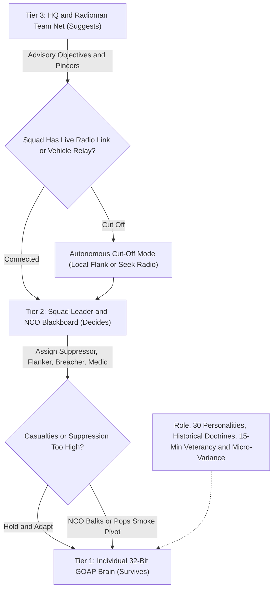

# Easy Red 2: Battle Hardened (`v0.9.11`)
*F.E.A.R.-Style 3-Tier GOAP, Humanized Vision & Footstep Hearing, Radioman Intel Nets, 15-Minute Veterancy, 30 Personalities & Combined-Arms Overhaul*

**[What Is Battle Hardened](#what-is-battle-hardened)** · **[Why Vanilla Needed That Push](#why-vanilla-easy-red-2-needed-that-extra-push)** · **[Install & Mod Compatibility](#installation-and-mod-compatibility)** · **[Multiplayer Matrix](#multiplayer-compatibility-matrix)** · **[What Changes In-Game](#what-changes-on-the-battlefield)** · **[3-Tier GOAP & Personalities](#3-tier-goap-architecture-and-personalities)** · **[Hotkeys](#in-game-hotkeys-and-menus)** · **[Verification & Performance](#automated-verification-and-performance-profiling)** · **[Engineering Deep-Dive](docs/design-and-justifications.md)** · **[Changelog](CHANGELOG.md)**

---

## What Is Battle Hardened

***Battle Hardened*** is a **zero-cheat tactical AI, Co-op, and combat immersion overhaul** for *Easy Red 2* (BepInEx 6 IL2CPP).

**Zero aimbots. Zero X-ray wallhacks. Zero artificial HP buffs.**  
Instead of making bots cheat, *Battle Hardened* makes every soldier, NCO, medic, radioman, tanker, and pilot **actually want to survive**—turning chaotic bot waves into reactive WW2 firefights where you feel like **one cog in a combined-arms battle** rather than the lone babysitter carrying your team.

* **Co-op Host-Only Friendly**: Host for **unmodded vanilla friends** (they experience the upgraded AI, resurrected vanilla voice lines, Host-Assist wood/top-attack penetration, and targeted radio/welcome briefings with zero install) or play **100% client-side** on vanilla servers.
* **Built for `140+` Bot Battles (`60 FPS` Target)**: Zero-allocation bitmask planning, chunked world/inventory snapshots, hardware-timer flight recording, and automatic `< 40 FPS` brain-tick backoff.
* **100% Live-Configurable (`F6`) & Toggleable (`F8`)**: Tune or disable **`106` options** across **5 tabs** mid-match from the `F6` menu (`BepInEx\config\com.antigravity.easyred2.humanai.cfg`), or press **`F8`** at any moment to switch cleanly back to 100% vanilla behavior without restarting.

---

## Why Vanilla Easy Red 2 Needed That Extra Push

Vanilla *Easy Red 2* is already a remarkable technical achievement: Marco built a sandbox capable of putting **140+ infantry, tanks, halftracks, artillery, and aircraft** onto huge destructible battlefields at 60 FPS.

To make battles that large run smoothly, however, vanilla's AI relied on lightweight stateless shortcuts (`GameAssembly.dll`) that break down once you look closely in a firefight:

| Area | What Vanilla Does Under the Hood | How *Battle Hardened* Fixes It |
| :--- | :--- | :--- |
| **Reaction & Brain Ticks** | `Creature.ProcessSequentialUpdates` ticks **only 1 unit per frame** (even dead or passenger slots) — leaving bots waiting **`~2.0–2.5s`** between brain updates in 140-bot battles, or frozen behind a flat `2.5s` `alertStartTime` delay. | **Adaptive Brain Scheduler (`~0.6s` latency)** skips wasted slots cleanly (backing off automatically if frame time exceeds `25ms`) and adds **Dynamic Human Reaction ("Watching vs. Caught Out")**: `0.18s–0.32s` if pre-aimed downrange vs. `0.38s–0.65s+` when caught sprinting or flanked. |
| **Sight Cones, Footsteps & Stealth** | When hidden, prone visibility is `37m`. The instant *any* squadmate fires (`IsEnemyAwareOfThisSquad`), every member jumps to **`300m` detection** and alerted bots skip FOV checks completely (**360° eyes in the back of their head**, even inside buttoned tanks!). | Preserves stance stealth (`150m` Standing / `80m` Crouched / `40m` Prone), reveals **only the soldier who fired** for `4.0s`, applies a continuous human **"Squint" cone** (`12m` close awareness narrowing smoothly to `±32°` long range), adds **`<= 20m` footstep & gunfire hearing** (crouch/prone silent, masked by explosions), and gives enclosed tank gunners narrow optical slits fed by a **`0.65s–1.48s` Commander Intercom handoff**. |
| **Self-Preservation** | Bots holster rifles to bandage in front of shooters, stand on the *enemy-facing side* of walls, walk upright or `prone`-roll randomly in open fields, ignore `Layer 14` walls when vaulting, and mag-dump rifles & frag grenades at Tiger armor. | **Survival comes first**: gunfire-driven leeward walls, cover-before-bandaging (`CanSafelyBandageNow`), `Layer 14` parapet/trench vaulting + direct trench drop-in, threat-arc Tank Fear evasion, smoke-screened retreats, and isolated shell-shock surrender & liberation. |
| **Teamwork & Macro Play** | Squads fight with static distance checks, abandon flags the second they're captured, camp *outside* capture circles, charge blindly into fatal funnels, and never depend on a Radioman to talk to HQ or tanks. | **3-Tier GOAP Chain of Command** where Radiomen carry the team's intel link, squads fight *inside* cap circles and garrison rear flags, NCOs balk at suicidal orders, and tank/air/artillery support actively screens for **you**. |

---

## Installation and Mod Compatibility

| Property | Details |
| :--- | :--- |
| **Target Branch** | Steam `public` (Default Branch) |
| **Confirmed Game Version** | **Easy Red 2 — Game Build `921`** (Steam Build ID `26375879`, Unity `2022.3.62f3` IL2CPP x64) |
| **Mod Loader** | **[BepInEx 6 Bleeding Edge (`BepInEx-Unity.IL2CPP-win-x64`, build `#791`+)](https://builds.bepinex.dev/projects/bepinex_be)** *(Windows & Linux/Steam Deck via Proton)* |
| **Last Confirmed Build & Suite Date** | **November 19, 2026** (`2026-11-19`) |

Download your preferred package from the **[Releases](https://github.com/sudravirodhin/easy-red-2-ai/releases)** page:

### 1-Click Auto-Updating Launcher (`Launch-BattleHardened.bat`) — *Recommended*
Download **[`Launch-BattleHardened.bat`](Launch-BattleHardened.bat)** (run it from anywhere on Windows, or create a Desktop shortcut to it):
* Automatically locates your Steam `Easy Red 2` folder, checks GitHub Releases for the latest version (`SHA-256` & version verified in `< 1s`), updates `EasyRed2HumanAI.dll` only when a newer release is available (or installs the full `*-with-BepInEx.zip` bundle on a fresh vanilla install), and **launches *Easy Red 2* via Steam automatically**.
* If you only want to update without launching the game, run **[`Update-BattleHardened.bat`](Update-BattleHardened.bat)** instead.

### Option A: With BepInEx Included (`EasyRed2HumanAI-v0.9.11-with-BepInEx.zip`) — *For Manual Fresh Installs*
Includes **[BepInEx 6.0.0-be.791 (Unity.IL2CPP-win-x64)](https://builds.bepinex.dev/projects/bepinex_be)**, the `.NET 6` runtime, Unity `2022.3.62` base libraries, pre-generated IL2CPP `interop` assemblies for Easy Red 2 Build `921`, `EasyRed2HumanAI.dll`, and `Launch-BattleHardened.bat` / `Update-BattleHardened.bat` (with no other third-party mods).
1. Open your **Easy Red 2** installation folder (e.g. `Steam\steamapps\common\Easy Red 2`, where `Easy Red 2.exe` is located).
2. Extract all contents of `EasyRed2HumanAI-v0.9.11-with-BepInEx.zip` directly into the `Easy Red 2` folder.
3. Launch the game via Steam or `Launch-BattleHardened.bat`!

### Option B: Without BepInEx / Plugin Only (`EasyRed2HumanAI-v0.9.11-Plugin-Only.zip` or `EasyRed2HumanAI.dll`)
For users who already have **[BepInEx 6 Bleeding Edge (`BepInEx-Unity.IL2CPP-win-x64`)](https://builds.bepinex.dev/projects/bepinex_be)** installed:
1. Download `EasyRed2HumanAI-v0.9.11-Plugin-Only.zip` (or `EasyRed2HumanAI.dll` directly).
2. Place `EasyRed2HumanAI.dll` into:
   ```text
   Easy Red 2\BepInEx\plugins\EasyRed2HumanAI.dll
   ```
   *(Using **[Quartermaster - ER2 Mod Manager](https://www.nexusmods.com/easyred2/mods/107)**? Import `EasyRed2HumanAI-v0.9.11-Plugin-Only.zip` directly in Quartermaster's Mods tab—do not import `with-BepInEx.zip`.)*

### Linux & Steam Deck Setup (via Steam Proton)
`EasyRed2HumanAI` works out of the box on **Linux Desktop** and **SteamOS / Steam Deck** with 100% Windows Co-op cross-play compatibility by running the Windows IL2CPP build under **Proton**:
1. **Force Proton in Steam** *(do not use the native Linux runtime, as BepInEx IL2CPP hooks `Easy Red 2.exe` / `GameAssembly.dll`)*:
   * Right-click **Easy Red 2** in Steam → **Properties** → **Compatibility**.
   * Check **"Force the use of a specific Steam Play compatibility tool"** and select **Proton Experimental** or **Proton 9.0+**. Let Steam finish downloading `Easy Red 2.exe`.
2. **Extract the Mod**:
   * Right-click **Easy Red 2** → **Manage** → **Browse local files** (`~/.steam/steam/steamapps/common/Easy Red 2/`).
   * Extract **`EasyRed2HumanAI-v0.9.11-with-BepInEx.zip`** directly into that folder (`winhttp.dll`, `doorstop_config.ini`, `dotnet/`, and `BepInEx/` next to `Easy Red 2.exe`).
3. **Add the Wine DLL Override Launch Option** *(Required on Linux/Proton so Wine loads BepInEx's `winhttp.dll` proxy)*:
   * In Steam → **Easy Red 2** → **Properties** → **General** → **Launch Options**, paste:
     ```bash
     WINEDLLOVERRIDES="winhttp=n,b" %command%
     ```
4. Launch the game! Verify `BepInEx/LogOutput.log` shows `Easy Red 2 - Battle Hardened v0.9.11 loaded!`. Both Windows and Linux/Proton players can Host or Join each other's Co-op lobbies.

### Switching to Vanilla or Uninstalling (`Uninstall-BepInEx-Mod.bat`)
Included in `EasyRed2HumanAI-v0.9.11-with-BepInEx.zip` (and in the root of this repository) is **[`Uninstall-BepInEx-Mod.bat`](Uninstall-BepInEx-Mod.bat)**. Run it inside your `Easy Red 2` folder when the game is closed to:
* **`[1] Play Vanilla Temporarily`**: Backs up `BepInEx`, `dotnet`, and `winhttp.dll` into `_BepInEx_Disabled_Backup\` so the game runs 100% vanilla without losing configs or plugins.
* **`[2] Restore Modded Game`**: Restores everything from `_BepInEx_Disabled_Backup\` in one click.
* **`[3] Uninstall Completely`**: Permanently deletes BepInEx and installed files.
*(Tip: Press **`F8`** in-game to disable the AI mod mid-match without restarting!)*

### Stacking With Other BepInEx Mods
* **Do not stack other full AI / movement overhauls** (e.g., *UngodlyAI*, *Advanced Combat Movement*)—multiple mods patching `SoldierAI`, `Creature.CanSee`, and `Squad` simultaneously will fight over bot locomotion and target selection.
* **Pairing with ballistics, gunplay, or visual mods** (e.g., *Realism Overhaul*, *Gunplay Overhaul*, *Better Scopes*): *Battle Hardened* includes optional armor/ballistics and QoL modules ([`BallisticsAndArmorRealism.cs`](src/EasyRed2AI/Modules/ImmersionAndQoL/BallisticsAndArmorRealism.cs), `TurretGun.SelectBestAmmo`). Every realism and QoL hook is independently toggleable live under **`F6 -> 3. Vision & Realism`** and **`F6 -> 5. Optimizations & QoL`**, so you can disable any overlapping ballistics/armor option without giving up the GOAP AI.

---

## Multiplayer Compatibility Matrix

Whether you are **joining a 100% vanilla server as a modded client**, **hosting a server for vanilla friends**, or running the mod on **both Host and Clients**, here is how every feature behaves over Photon (`PUN2`):

| Feature / System | Category | Joining a Vanilla Server (Client-Only Mod) | Hosting for Vanilla Friends (Host-Only Mod) | Host + Clients Both Modded |
| :--- | :--- | :--- | :--- | :--- |
| **Plane Engine Loop De-Throbber** (`EnablePlaneAudioSmoothing`) | **100% Client-Side** | **Works 100%** for you | Host hears smoothed plane audio; vanilla clients hear vanilla audio | **Everyone** hears smoothed plane audio |
| **Death Screen Kill Attribution + Age & `F7` Dogtag Archive** | **100% Client-Side** | **Works 100%** for you | Host sees full obituary & archive; vanilla clients see vanilla death screen | **Everyone** sees full obituary & archive |
| **Quick-Tap `Tab` Spotting & 64-Char Room Names** | **Client UI / Host Room Name** | **Works 100%** for you | Vanilla clients see your full 64-char server name! | **Works 100%** for everyone |
| **3D Veteran Badges, Roster Tags, Spectator HUD (`F`), 4K UI Scale, Objective Factions & `F5`/`F6`/`F7`/`F8`/`F9`/`F10`** | **100% Client-Side UI** | **Works 100%** on your HUD | Host only (vanilla clients see **3D uniform shoulder rank decals** synced by Host) | **Everyone** sees HUD tags, 3D badges & decals |
| **Macro Objective Director, Garrisons, Attrition Pivots, Emplacements & Smart APCs** | **Host-Driven (Synced to All)** | Inactive (Host controls autonomous squads) | **Vanilla clients experience 100%!** Host assigns squad tasks and Photon syncs movements & dismounts to vanilla players. | **Works 100%** for everyone |
| **All Autonomous Enemy & Friendly AI Squads (Vision, Footstep Hearing, GOAP, Radios, Resurrected Vanilla Voice Lines, Cover, CQB, Anti-Armor, Tank Intercom & Staggered Bailout)** | **Host-Driven (Synced to All)** | Inactive for host-owned bots | **Vanilla clients experience 100%!** Even a vanilla client's **own on-foot AI squadmates** remain simulated by the Host (`0x180A71EE2`) and emit native Photon `SyncSay` voice lines! | **Works 100%** for everyone |
| **Vehicle & Aircraft Physics / Flight & Photon Sync** | **100% Pure Vanilla Sync** | Pure vanilla network sync | **100% wire-compatible vanilla flight & driving sync!** No custom vehicle/plane Photon overrides that cause client snap-teleports. | **100% pure vanilla physics & sync** |
| **AI Crewmates Inside a Client-Driven Tank/Vehicle** | **Client-Owned Vehicle Crew** | **Works 100%** for your vehicle's AI gunners/repair crew! | Vanilla client's own tank crew uses vanilla AI while that client drives | **Works 100%** for everyone |
| **Thin-Cover Wood Bullet Penetration (`"bh_ver"` Host-Assist)** | **Per-Shooter + Host-Assist** | Works for you & locally owned units | **Vanilla clients experience 100%!** Host applies thin-wood bullet penetrations for unmodded teammates without double-damage. | **Works 100%** for everyone |
| **Multiplayer Scoreboard (`Kills`/`Deaths`/`Score`), Client Roadkills, Targeted Host MOTD & Battle Stat Sync** | **Host-Authoritative / Synced** | Scoreboard fix works for your kills/deaths; Roadkills & match stats sync when Host runs mod | **Vanilla clients experience 100%!** Unmodded friends can roadkill enemy bots, see sorted scoreboards, and receive faction-language welcome briefings & targeted WWII radio chat. | **100% synchronized** on Host & Clients |
| **Aircraft Top-Attack AP (`"bh_ver"` Host-Assist)** | **Per-Shooter + Host-Assist** | Works for your own aircraft AP passes | **Vanilla clients experience 100%!** Host applies top-attack roof penetrations for unmodded teammates without double-damage. | **Works 100%** for everyone |
| **Enclosed Tank Crew Blast & Airplane Canopy/Belly Armor** | **Per-Victim Owner** | Protects you & locally owned crew | Protects Host + **all Host-owned AI tank crews & pilots** | **Works 100%** for all players and AI |

---

## What Changes on the Battlefield

### 1. Infantry Self-Preservation, Cover, Trench Drop-In & CQB ([`Modules/Infantry/`](src/EasyRed2AI/Modules/Infantry/))
* **Committed Fire-and-Movement**: Replaces vanilla's stuttery `crouch -> 1-step run -> crouch` shuffling and `50%` open-field `Prone` rolls with hysteresis-locked **upright sprints (`4.8s–6.8s`)** alternated with **deliberate kneeling firing halts (`3.7s–5.35s`)**, instant `"Shot-At"` startle drops to cover when fired on, and blind-corner **pieing** (`<= 115°` cap, disabled when evacuating so retreating troops never moonwalk backward) around doorways and trench bends.
* **Gunfire-Driven Leeward Cover, Crossfire & Barrel Clearance**: Computes live dominant enemy gunfire vectors and circular crossfire coherence (`R < 0.82f`) so bots stand **behind** walls—never on the enemy-facing side without ping-ponging—step into roofed interiors or trenches for `Prone` shelter under crossfire while staying low (`Crouch`) under windowsills, **pop up** smoothly over waist-high sandbags only during firing bursts, sidestep door/pillbox jambs cleanly without standing into concrete lintels, and cross spans using **bridge parapets, tank hulls, and bipods** without jumping off into rivers (`SoldierAI.GetSpacingFromSquad` fix).
* **True Obstacle Vaulting, Trench Drop-In & Door/Shutter Discipline**: Fixes Layer 14 `InvisibleTrepassableWall` and thin-fence probes so bots reliably **vault low walls, sandbags, and trench parapets**, adds direct **trench drop-in** steps (`TryStepOffIntoTrench`) overcoming `CPathFinding`'s `1.12m` drop rejection without teleporting or climbing sloped hills (`TerrainCollider`) or barbed wire unless wedged, rejects `Vehicle` hull colliders from foot pathing/vaulting, opens doors strictly along travel/firing lanes, closes trailing doors behind squads, and pulls window shutters shut when pinned or reloading.
* **Decisive Melee, Un-Bayoneted Reach & Shell-Shock Surrender**: Fixes integrated bayonet mounting (zero RPC bursts), extends AI un-bayoneted `MeleeDamageCR` capsule reach (`0.37m -> 0.95m`, `1.45m` across static-gun tripods) so pistol-whips/buttstrokes/knives don't whiff, stops CQB melee spinning with `±52°` 2-man pincers and crouch/prone stance matching, suppresses melee charges into `<= 15m` gunfire when holding loaded firearms (keeping loaded pistols firing down to `0.72m` and breaking `melee_whiff_loop` stalemates after `3` whiffs), fixes downed-casualty vs. surrender standing-zombie bugs (`IsInjured` + `SetAnimatorController`), and allows isolated Skittish/Rookie troops without an officer nearby to dynamically **surrender** (`SurrenderSynched`)—and later be liberated back into combat.

### 2. Squad Teamwork, Emergent Field Radios, Hearing & Combat Triage ([`Modules/Goap/`](src/EasyRed2AI/Modules/Goap/))
* ***F.E.A.R.* Pin-and-Flank & 3-Tier Balking**: Squad Blackboards (`0.60s–1.05s` staggered, `<= 3` refreshes/tick) coordinate Suppressors, `20°–75°` Flanking teams, Breachers, and Medics. Both NCOs and individual soldiers track fresh squadmate casualty zones (`20m` / `18s` hazard memory), **refuse or abort** suicidal pushes (`Balk:` telemetry), and prioritize survival preemption (`ScavengeForbiddenMask` + `suppression >= 5.0f` cutoff) over mid-firefight looting.
* **Close-Range Footstep & Gunfire Hearing (`<= 20m`) + 4 Resurrected Vanilla Voice Lines**: Zero-allocation footstep ring buffer detects enemy standing sprints (`<= 17m`) and walks (`<= 9.5m`) while keeping crouched and prone movement silent—masked by `50%` during nearby gunfire/explosions (`<= 35m`, `3s`), triggering alert snap-turns and at most **one cautious squad investigator** rather than breaking whole-squad formation. Also wires **4 unused universally populated vanilla voice clips (`492` clips across all `48/48` voice sets)** (`iVeBeenHit`, `attackThatTank`, `attackThatVehicle`, `yes` + safe `keepYourHeadDown` fallback) over native `Soldier.SyncSay` so unmodded Co-op friends hear them too.
* **Emergent Field Radio & Medic Inheritance**: When a squad loses its Radioman or Medic, surviving squadmates scavenge **fallen friendly or captured enemy field radios** (explicitly strapping them on via `Soldier.SetWerable` and retuning enemy frequencies onto your net, while Radiomen prioritize combat safety over rubber-banding back to the leader) or recover **atomic 3-of-3 syringe kits** from dead Medics (protecting dead Medics near human players), alongside picking up knocked-off or **player-gifted helmets**, **AT launchers**, and ammo from floors, corpses, and `AmmoRefillCrate`s.
* **Anti-Dogpile Medics, Casualty Dragging & `"Less is More"` Squad Merges**: Caps wounded casualties to 1 primary medic (`DriveMedicHealingApproach` fixes `MedicHealingDestination` freezes), lets riflemen carry downed buddies out of killzones, locks AI Squad Leaders with followers onto shared objectives (`FollowLeader`), steers grounded/bailed tank crews back to safety, lets soldiers borrow ammo/bandages from living Medics & Ammo Carriers at a `2.5m` standoff, and cleanly merges lone survivors into nearby healthy leaders (`!IsInjured`) via vanilla `Squad.Join` (`<= 18m` SL cohesion guard).
* **Sapper Special Munitions & Mine Avoidance**: Engineers/AT Sappers deploy AT/AP pressure mines with strict friendly/spawn/cap-zone safety buffers, hurl heavy satchel/demo charges against fortifications and armor (`9m` clear step-back), and build deployable tripods—while allied infantry and vehicles steer/brake around placed mines.

### 3. Relentless Objective Play, Radio Intel Nets & Spawn Safety ([`Modules/MacroAndVehicles/`](src/EasyRed2AI/Modules/MacroAndVehicles/))
* **Both Armies Play to Win**: Clamps cover searches inside capture circles (`0.80 * radius`), maintains a doctrinal **rear-guard garrison (`16%–28%`)** with instant **Back-Cap Alarms** across all 215+ vanilla campaign missions (`ME_*`, `sp_ME_` V2, Dynamic Conquest, Wave Defense, Lua `#retreat`, Workshop missions), and triggers smoke-screened **multi-squad attrition pivots** (`CountAlliedGroundSquadsOnObjective` + 1-per-frame RPC-paced order queue) rather than throwing infinite waves into an entrenched meatgrinder.
* **Anvil & Hammer Supporting the Human Player**: Radio-connected squads and tanks automatically pair up to pin and flank enemy strongpoints—and when **your Human Player squad** is connected to the Radio Net and pinned down, the Team Net treats you as the **Anvil** and dispatches an AI **Hammer** squad to flank the enemy pinning you (or suggests your next priority target if you have no active order).
* **Pure Player `ConquestEconomy` & Coastal Spawn-Drown Rescue**: Keeps `ConquestEconomy` strictly as the **human-player requisition wallet** (matching vanilla's `if (isPlayer)` gate at `0x1806AB133` so AI bots use free wave timers/slots and never starve players of armor/air spawns), while `SpawnManager._SpawnUnit_d__37` rescues offshore/underwater spawns and boat-capacity overflows onto nearby walkable shoreline or dry friendly spawners (`SpawnSaved:`).

### 4. Fair Human Vision, Tank Commander Periscope & Realistic Ballistics ([`Modules/Vision/`](src/EasyRed2AI/Modules/Vision/) & [`Modules/ImmersionAndQoL/`](src/EasyRed2AI/Modules/ImmersionAndQoL/))
* **Fair Vision & Window-Aperture Alignment**: `150m` Standing / `80m` Crouched / `40m` Prone stealth with `4.0s` individual shooter reveals, continuous human "squint" cones (`<= 12m` close awareness narrowing smoothly to `±32°`), `0.18s–0.65s+` human reaction curves, optic zoom scaling (`<= 2.25x`), native `AngleToDirection` `90°` gaze fix, window-opening centering for indoor defenders, `15m` vocal threat-sector callouts, and last-known suppressive fire / frag flushes.
* **Active 360° Tank Periscope, Intercoms & Armor Realism**: `TurretCommander` actively rotates (`55°/s` or toward `<= 185m` gunfire) with directional periscope optics (`78° -> 62° -> 42°`) and an `11.5m` hull-depression dead zone paired with **`0.65s–1.48s` Commander & escort-infantry intercom callouts** into narrow `±15°–34°` enclosed gunner slits; enclosed crew protection against external frag grenades and collider-clipping small arms; tent/soft-prop `0`-armor tank collision immunity; Molotov fire immunity for steel tank tracks with upper-hull engine/fuel seepage; diving aircraft **top-attack AP roof normalization** (with automatic **Host-Assist for unmodded Co-op clients!**); armored airplane belly/floor protection against rifle-caliber ground fire; thin-cover **wood bullet penetration**; and underwater/through-smoke **ghost blood occlusion**.

### 5. Combined Arms: Armor, Emplacements, Air Superiority & Staggered Bailouts ([`Modules/MacroAndVehicles/`](src/EasyRed2AI/Modules/MacroAndVehicles/) & [`VeterancyAndPersonalities.cs`](src/EasyRed2AI/Modules/ImmersionAndQoL/VeterancyAndPersonalities.cs))
* **"Less is More" Pure Vanilla Driving, Flight & Network Sync + Tactical Layer**: Vehicle driving (`UpdatePath`/waypoints), aircraft flight physics (`FlightModel`), and vehicle/plane Photon synchronization run **100% pure vanilla** on Host and Clients (zero client snap-teleports or off-road tank path collisions). On top of pure vanilla locomotion, *Battle Hardened* layers personality-scaled standoff (`50m–95m`), `<= 35m` AT reverse/blast displacement, **Known / Marked / Radio-Requested** target priority, building-facade shelling for spotted indoor enemies, friendly infantry corridor right-of-way, leeward repair positioning & `RepairStation` resupply, and true **`ShellType.APHE` vs. `HE`/Coax MG/`Flak` munition selection** (`TurretGun.SelectBestAmmo` + `TurretWeapon.Reload`, fixing vanilla `BulletData.IsHe()` treating `APHE` as `HE`).
* **Emplacements, Anti-Armor Infantry, Air Rearm Rescue & Staggered Tank Crew Bailouts**: Proactively crews 2-seat static guns (`<= 32m` player squadmates automatically assist on open loader/traverse seats and `"Get In"` orders stay protected), bails gunners out when flanked within `18m` outside arc or rushed inside `8.5m` off-bore/reloading, keeps stowed AT launchers out against armored cars/halftracks (`SoldierAI.UseBestWearedWeaponCheck`), enforces threat-arc **Tank Fear** + blind-side AT stalking, blocks `< 12mm` frags on buttoned tanks, restores `2200m`/`4000m` air detection + carrier/island `NeedRefill` rearming rescue, restricts Japanese *Tokkōtai* dives strictly to severely crippled (`>= 80` damage / missing wing) planes, staggers crippled tank crew exits (**`0.15s–0.45s` hatch queue + `2.1s–4.0s` crouch/prone shock scramble** with `32m` self-defense before evacuating), and gives ejected **Pilots, 6–10 seat Bomber Crews, and Tank Crews** working on-foot `"Retreat"` objectives (including ocean ditching zones).

### 6. Emergent WW2 Storytelling, QoL & 60 FPS Co-op Polish ([`Modules/ImmersionAndQoL/`](src/EasyRed2AI/Modules/ImmersionAndQoL/) & [`UI/`](src/EasyRed2AI/UI/))
* **15-Minute Veterancy (`Pvt.` $\rightarrow$ `1st Sgt.`) & 30 Personalities across 20+ Doctrines**: Survivors sharpen steadily up to a realistic `20%` dispersion cap, earn visible **3D shoulder rank promotions**, and fight according to 30 distinct archetypes and historical doctrines.
* **Obituary, `F7` Dogtags, Squad Roster/Map/3D Letters, Reload Cancel, `F5` Playlists & Co-op Polish**: Instant full-opacity **Death Screen Obituary** with weapon/ordnance caliber (`APHE`/`HEAT`/`AP`/`HE`/`Flak`), hit zone, distance, and soldier **Age (`1925 - 1944 (Age 19)`)**; searchable **`F7` Dogtag Collection Archive**; **Bottom-Left Squad Roster Header & Names**, optional **Own-Squad-Only 3D Overhead Names** (`<= 65m` with 1:1 native hover deduplication), and friendly-only **Map & 3D World Squad Letters (`A`, `B`, `C`...)** (Gold `#FFE040` own squad, crisp White allies, pooled recycling fixed); **Tactical Reload & Bipod Animation Canceling** without fast-reload exploits; Client-side **Plane Engine Loop De-Throbber**; Quick-Tap **`Tab`** spotting, **64-char** room names & **targeted faction-language Host MOTD**; Host-authoritative **Multiplayer Casualties/Prisoners/Lost Vehicles** stat sync; **4K UI Scaling**; Spectator **`F`** view cycling + **Top-Center Bot GOAP Inspector**; standalone **`F5` Campaign, Multi-Map Playlist & Unit-Scale Picker** (background catalog pre-loading, `[★ATK|☆DEF]` per-side completion badges, `CampaignsTree.ExploreBranch` mission ordering, **`Campaign From Here`**, and `25%–300%` Allies/Axis bot scaling); plus **Co-op Host Alt-Tab stability (`45 FPS` unfocused cap)** and chunked zero-GC `WorldSnapshot` + **Host Ping Governor**.

---

## 3-Tier GOAP Architecture and Personalities

Most shooter mods rely on **static rule trees** (*"if HP < 50 -> bandage; else if enemy visible -> shoot"*). Rule trees break the moment two edge cases overlap—leaving bots paralyzed, oscillating poses, or walking straight into ambushes.

**GOAP (Goal-Oriented Action Planning)**—pioneered by Jeff Orkin for *F.E.A.R.* (2005)—flips that around. Each soldier evaluates **Goals** (*Stay Alive, Stop Bleeding Safely, Break Suppression, Flank Pinned Enemy, Counter Armor, Restore Squad Radio*) against **Actions with Preconditions & Effects** using a zero-allocation **32-bit bitmask planner** organized as a **3-Tier Chain of Command ("HQ Suggests -> NCO Decides -> Soldier Survives")**:



No two soldiers of the same nation fight identically: zero-allocation MurmurHash3 bit-mixing gives every individual bot continuous **Micro-Variance** (`AggressionCostMult`, `CautionCostMult`, reaction jitter, and suppression jitter) on top of their **Role**, **30 Archetype Personalities**, **Historical Doctrines**, and **15-Minute Veterancy**.

<details>
<summary><b>Click to expand the 30 Role-Based AI Personalities reference table</b></summary>

| Role | Personality 1 | Personality 2 | Personality 3 |
| :--- | :--- | :--- | :--- |
| **1. Squad Leader** | **`[Spearhead]`**: Grants nearby squadmates (`< 22m`) `+12` suppression grit and leads aggressive pushes. | **`[Tactician]`**: Faster artillery/radio support checks and tight cover discipline. | **`[Old Guard]`**: Defensive anchor; prioritizes squad survival and rescues pinned comrades. |
| **2. Assaulter / SMG** | **`[Shock]`**: Resists dropping `Prone` until extreme suppression (`>= 68`) and bounds aggressively. | **`[Breacher]`**: Rapid `2.0s` peek cooldown (`<= 38` suppression) and eagerly tosses frag grenades. | **`[Skirmisher]`**: Expands lateral spacing (`1.45x`) to flank wide into CQB. |
| **3. Rifleman** | **`[Regular]`**: Balanced baseline fire-and-maneuver (`35` suppression threshold). | **`[Cautious]`**: Drops low at light suppression (`>= 18`), stays ducked longer, sheds jitter as `[Composed]` Vet. | **`[Grenadier]`**: Prioritizes rifle-grenades and hand grenades within throwing range. |
| **4. Machine Gunner** | **`[Anchor]`**: Prioritizes wall/parapet bipods and holds under heavy fire (`>= 60` suppression). | **`[Assault MG]`**: Advances with the rifle squad and deploys ground bipods in `Crouch`/`Prone`. | **`[Overwatch]`**: Holds medium-long range (`50m–160m`) overwatch cover to pin threats. |
| **5. Marksman / Sniper** | **`[Deadeye]`**: `12%` tighter accuracy when firing from `Crouch` or `Prone`. | **`[Stalker]`**: `35%` shorter firing-reveal duration from concealed cover. | **`[Spotter]`**: `+5°` wider scoped optic cone for counter-sniping. |
| **6. Anti-Tank / Sapper** | **`[Tank Hunter]`**: Stalks armor in crouch stealth and aims for tracks/weak spots. | **`[Ambusher]`**: Holds fire behind cover until armor enters kill range (`< 68m`). | **`[Demo]`**: High suppression grit (`>= 60`) when closing for AT/satchel/grenade attacks. |
| **7. Field Medic** | **`[Heroic]`**: Braver under fire (`<= 52` suppression) and searches `1.5x` wider (`45m`) to rescue/liberate. | **`[Combat Medic]`**: Balanced combat-first medic (`35` suppression); clears close threats before treating. | **`[Triage]`**: High self-preservation (`20` suppression, longer cover-seek) to stay alive for the squad. |
| **8. Tank / Armor Crew** | **`[Brawler Crew]`**: `20%` faster turret target switching and `50m` close-support standoff. | **`[Sniper Crew]`**: `+5°` wider long-range turret optic cone and `95m` armor-duel standoff. | **`[Support Crew]`**: Prioritizes infantry support (`72m` standoff) and fast radio-request response. |
| **9. Light Vehicle / AA** | **`[Outrider]`**: Fast-reacting mobile gunner/driver (`20%` faster turret refresh). | **`[Escort]`**: Cautious standoff support and higher self-preservation when repairing. | **`[Flak Watch]`**: `+12°` wider scan sector in `TurretAI.CanSee` for tracking aircraft. |
| **10. Aircraft Pilot** | **`[Ace]`**: Extended dogfight pursuit leash (`fighterDogfightExtraLeash = 450m`). | **`[Daredevil]`**: Commits closer on CAS dive-bombing runs (`0.90x diveAlignDistance`). | **`[Disciplined]`**: Pulls out of dives earlier (`1.08x diveAlignDistance`) for safer bomb releases. |

</details>

For the native `GameAssembly.dll` root causes and system architecture behind all **28 C# modules**, see **[`docs/design-and-justifications.md`](docs/design-and-justifications.md)** and **[`CHANGELOG.md`](CHANGELOG.md)**.

---

## In-Game Hotkeys and Menus

Every feature is organized into **5 Concept Tabs** (`1. GOAP & Bot Behaviors`, `2. Vanilla Fixes`, `3. Vision & Realism`, `4. Vets & Roles`, `5. Optimizations & QoL`) with one-click **`[ALL]` / `[OFF]`** section buttons in the **`F6`** menu (`BepInEx\config\com.antigravity.easyred2.humanai.cfg`):

* **`F` (in Free Camera / Auto-Spectator)**: Cycle Spectator Tactical View (**`Full Tactical`** $\rightarrow$ **`Objectives Only`** $\rightarrow$ **`Clean Cinema`**), completely independent of Photo Mode's camera UI toggle.
* **`F5`**: Open/Close the standalone **In-Game Campaign, Playlist & Mission Picker** (Singleplayer & Multiplayer Host: build `[+]`/`[#N]` multi-map playlists, launch or queue **`Campaign From Here`**, tune next-map Allies/Axis **Bot Scale (`25%–300%`)**, and switch/queue across all campaigns with `???` unlock masking).
* **`F6`**: Open/Close the **5-Tab Modular Feature Menu** (toggle all `106` config options live mid-match and scale UI size for 1440p/4K).
* **`F7`**: Open/Close the **Searchable Dogtag Collection Archive** (`Brought Home` vs. `Enemy Trophy`, `My Kills`, birth–death age, rarity, and battle filter).
* **`F8`**: Master Toggle Mod **ENABLED / DISABLED** live in-game.
* **`F9`**: **Hot-Reload** `.cfg` from disk without restarting.
* **`F10`**: Display the **5-Line Live Tactical Telemetry Card** (`Vet`, `GOAP`, `Balk`, `RadioLoot`, `Anvil`, `FragBlk`, `Intercom`, `Hitches`, etc.). Zero-overhead opt-in **`EnableBotActionTrace`** (`BepInEx/BotActionTrace.jsonl`) and **`EnableHitchFlightRecorder`** toggles live under `F6 -> 5. Optimizations & QoL -> Developer Diagnostics` (default `OFF`).

---

## Automated Verification and Performance Profiling

Every change compiles through an automated verification pipeline and has been profiled in live `120–145` bot Co-op stress tests:

### 1. Static Signature Checks & Headless Simulations (`.\build.ps1 -Test`)
| Verification Stage | Scope | Verified Result |
| :--- | :--- | :--- |
| **IL2CPP Harmony & Animator Verifier** ([`VerifyPatches.cs`](tools/verify_patches/VerifyPatches.cs)) | All `[HarmonyPatch]` classes, `Plugin.Load` `SafePatch` registration CIL audit, and Animator state/parameter strings vs. native `Soldier.asm` | **`155` HarmonyPatch signatures verified (`0` mismatches)**; **`14` Animator string literals verified (`0` mismatches)** |
| **GOAP, Acoustic & Ground Probe Suite** ([`VerifyGoapPlanner.ps1`](tools/verify_patches/VerifyGoapPlanner.ps1)) | Combinatoric GOAP state space, footstep/acoustic ring buffer & noise masking, slope/capsule probes, CQB standoff invariants | **`24,601` assertions passed across `9,920` combinatoric states (`0` failures)** |
| **Deterministic Battle Loss & Emergence Model** ([`Run-BattleLossModel.ps1`](tools/verify_patches/Run-BattleLossModel.ps1)) | **`687` battles** (`229` scenarios × `3` seeds covering **`215` real campaign missions**, Dynamic Conquest, Wave Defense, Demolition, Breakout/Retreat, **`21/21` doctrine profiles**) | **`8,802,845` GOAP plans in `5.48s`**; **`0` across all `8` zero-tolerance loss counters** (incl. `16,484` prisoner/bailed-crew zombie audits); **`8/8` determinism**; **`229/229` cross-seed divergence**; `3.12` concurrent distinct GOAP actions / engaged squad |

### 2. In-Game Flight Recorder Telemetry (`HitchAutopsy` & `AnomalyWatchdog`)
Measured across live `24.5-minute` (`117,266` frames) and `41.5-minute` Co-op matches (`120–145` active bots, `0` mod exceptions):
* **Sustained `60 FPS`**: `16.66ms–16.72ms` average frame time across `117,266` recorded frames (with `DebugLogging` active during the 24.5-minute trace).
* **Single-Frame Mod Spikes Eliminated**: `GoapScavenge` (`114.5ms -> <= 0.25ms`), `GoapFloorSnap` (`95.5ms -> <= 0.15ms`), `Emplacements` (`12.3ms -> 0.00ms`), `DictCleanup` (`7.0ms -> 0.00ms`), plus `TeamNetGoap` `22ms–30ms` spikes eliminated via `<= 3` squad refreshes/tick and cached AT checks.
* **Allocation & GC Reduction**: Managed `.NET 6` allocations cut **`5x–9x`** (`10.5–21.7 KB/frame -> 2.05–4.5 KB/frame`, `6` `.NET 6` GCs across `24.5` min); peak `IL2CPP` Boehm churn cut from `347.5 KB/frame` (`23` GCs/`15s`) down to `53–164 KB/frame` (`1–3` GCs/`15s`).
* **Runtime Diagnostics (Default `OFF`)**: 40-bucket [`HitchProfiler`](src/EasyRed2AI/Core/HitchProfiler.cs), lock-free ring-buffered [`BotActionTrace`](src/EasyRed2AI/Core/BotActionTrace.cs) (`BotActionTrace.jsonl`), and a 5-detector runtime `AnomalyWatchdog` (`surrender_pose_mismatch`, `prisoner_ignored_by_allies`, `retreat_despawn_stalled`, `melee_whiff_loop`, `idle_in_open_zombie`).

### 3. Test Hardware Transparency
Live game profiling runs were captured on a high-end test system:
* **CPU**: AMD Ryzen 7 9800X3D (8-Core) · **GPU**: AMD Radeon RX 7900 XTX · **RAM**: 64 GB · **OS**: Windows 11 Pro

While raw FPS ceilings depend on your CPU, the mod's optimization work targets **hardware-independent bottlenecks** that help lower-spec and mid-range PCs too: cutting per-frame managed/IL2CPP GC allocations (`KB/frame`), bounding spatial/inventory scans across chunked frames, caching linecasts/ceilings/doors, dynamically backing off extra AI brain ticks whenever frame time exceeds `25ms` (`< 40 FPS`), and pacing Co-op host updates under network/background load.

---

## Building From Source

Run [`build.ps1`](build.ps1) from PowerShell (auto-discovers your Steam `Easy Red 2` installation and `.NET 6` Roslyn compiler, compiles all **28 modules** under [`src/EasyRed2AI/`](src/EasyRed2AI/), runs [`VerifyPatches.cs`](tools/verify_patches/VerifyPatches.cs) against `Assembly-CSharp.dll` and native `Soldier.asm`, and checks that `Easy Red 2.exe` is closed before deploying). Add `-Test` to also run the headless GOAP/Acoustic/Ground-Probe suite (`VerifyGoapPlanner.ps1`) and the **687-battle Deterministic Battle Loss & Emergence Model** (`Run-BattleLossModel.ps1`):

```powershell
powershell -ExecutionPolicy Bypass -File .\build.ps1 -Test -Deploy
```

---

## Development Methodology, AI Disclosure, and Credits

> **Disclosure — AI-Assisted Development:**  
> AI / LLMs were used in the development of this mod. I'm a developer by trade and worked on this with an LLM in my free time alongside hours of testing and polish. Putting this upfront in case you prefer to avoid AI-assisted mods.

**Credit & Inspiration:**  
Special credit and thanks to **[AtlasActual (`Easy-Red-2-Realism-Overhaul`)](https://github.com/AtlasActual/Easy-Red-2-Realism-Overhaul)** for pioneering several of the combined-arms, objective-coordination, and tactical realism concepts that inspired parts of this project's roadmap and feature sets.
